<p align="center">
  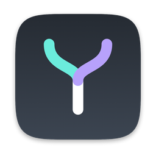
</p>

<h1 align="center">YourHarness</h1>

<p align="center">
  <b>A fast, native macOS home for AI coding agents.</b><br>
  Many threads across many projects, memory that carries across sessions, a browser Claude can see through,<br>
  and your iPhone along for the ride. Written in Rust, drawn on the GPU.
</p>

<p align="center">
  <a href="https://github.com/mdovhopo/yourharness/releases/latest"></a>
  
  
  
  
</p>

<p align="center">
  <a href="https://github.com/mdovhopo/yourharness/releases/latest"><b>Download</b></a> ·
  <a href="#features">Features</a> ·
  <a href="#on-your-iphone">iPhone</a> ·
  <a href="#why-its-fast">Why it's fast</a> ·
  <a href="#build--run">Build from source</a>
</p>

<p align="center">
  <picture>
    <source media="(prefers-color-scheme: dark)" srcset="docs/media/files-dark.png">
    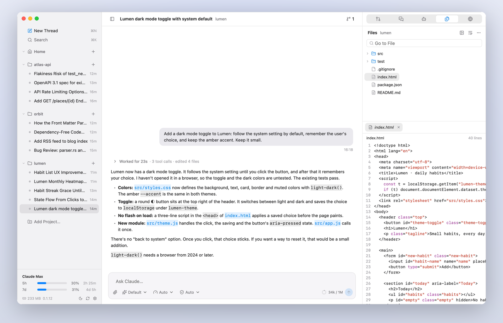
  </picture>
</p>

YourHarness drives the official agent CLIs you're already signed in to, and builds a better day-to-day experience on top. Bring your own subscription: it runs the real CLI and never reads or stores your credentials. Claude Code is supported today; the core is agent-agnostic, and more CLIs are planned.

## See it in action

<p align="center">
  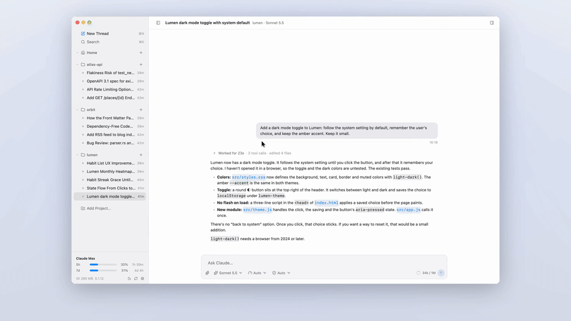
</p>

<p align="center">
  <a href="https://github.com/mdovhopo/yourharness/raw/main/docs/media/overview.mp4">
    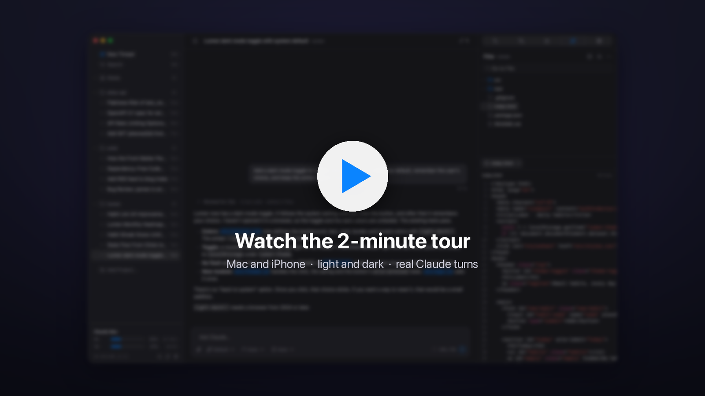
  </a>
  <br>
  <sub>The 2-minute tour: real Claude turns on the Mac and the iPhone, light and dark, with captions (<a href="docs/media/overview.srt">.srt</a>).</sub>
</p>

## Features

<table>
  <tr>
    <td width="50%" valign="top">
      <picture>
        <source media="(prefers-color-scheme: dark)" srcset="docs/media/markdown-dark.png">
        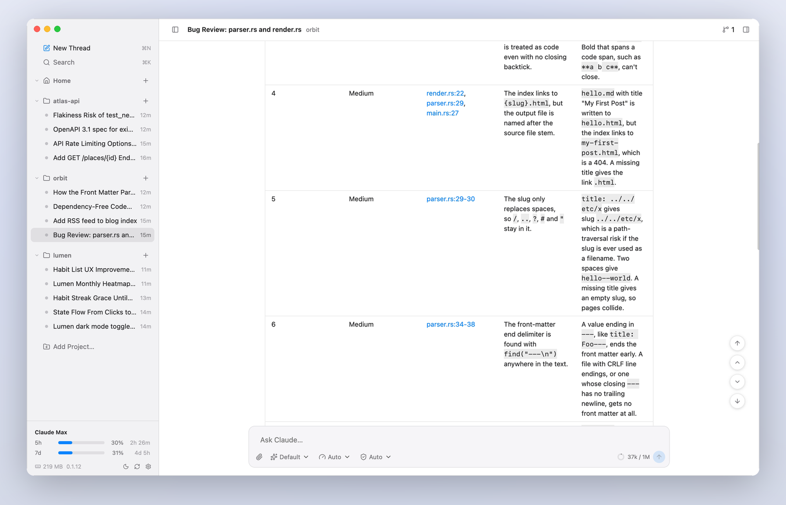
      </picture>
      <h3>A transcript that keeps up</h3>
      Markdown with highlighted code and tables, tool calls as compact steps that open into their input, output and diffs, sub-agents with their own steps. Smooth however long the thread gets.
    </td>
    <td width="50%" valign="top">
      <picture>
        <source media="(prefers-color-scheme: dark)" srcset="docs/media/diagram-dark.png">
        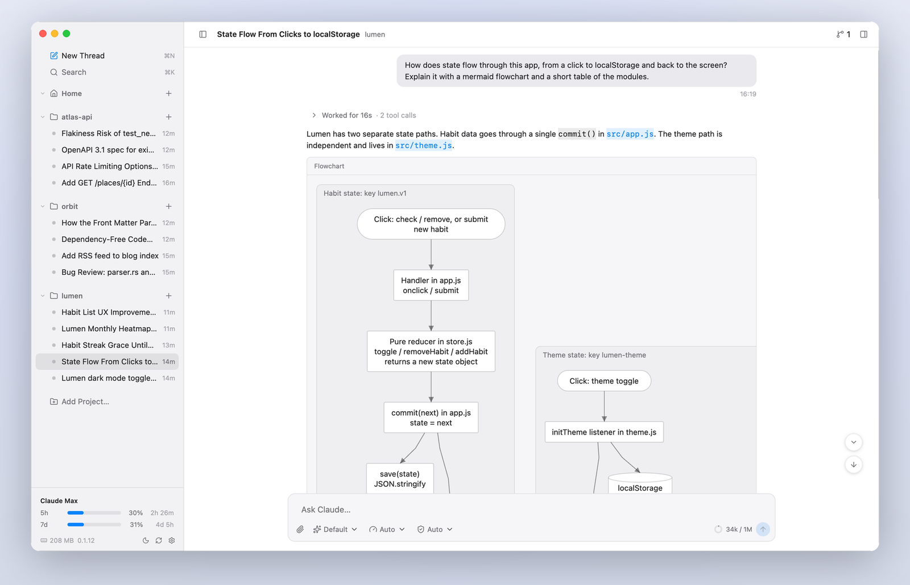
      </picture>
      <h3>Diagrams, drawn natively</h3>
      Mermaid flowcharts and sequence diagrams right in the conversation, with zoom, copy and PNG export.
    </td>
  </tr>
  <tr>
    <td width="50%" valign="top">
      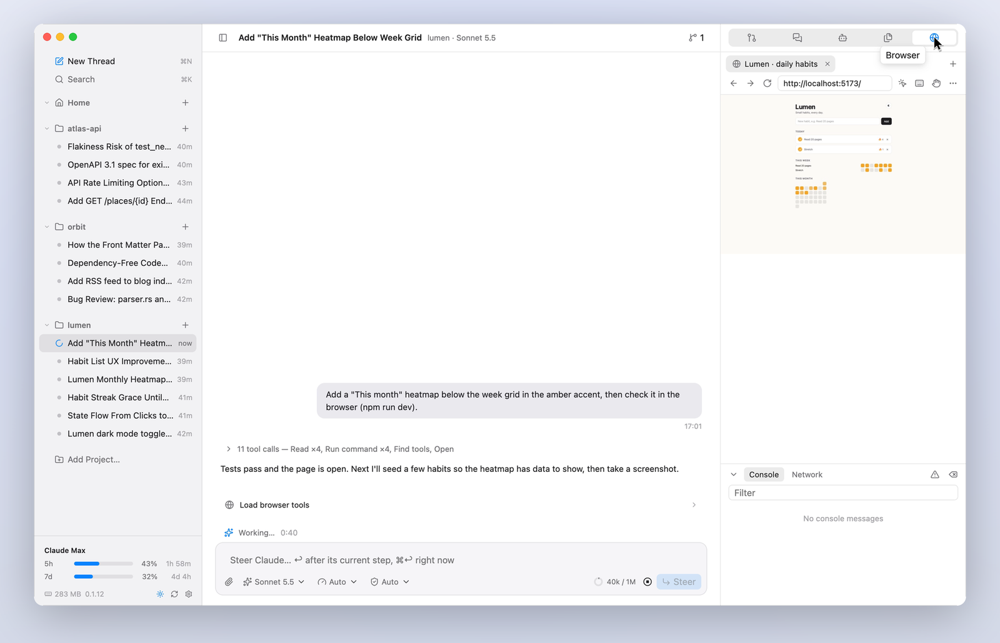
      <h3>A browser Claude can see through</h3>
      Claude opens, reads, clicks, types and screenshots real pages (your dev server, a sign-in flow) in a browser beside the thread. Watch it work, take control at any time.
    </td>
    <td width="50%" valign="top">
      <picture>
        <source media="(prefers-color-scheme: dark)" srcset="docs/media/memory-dark.png">
        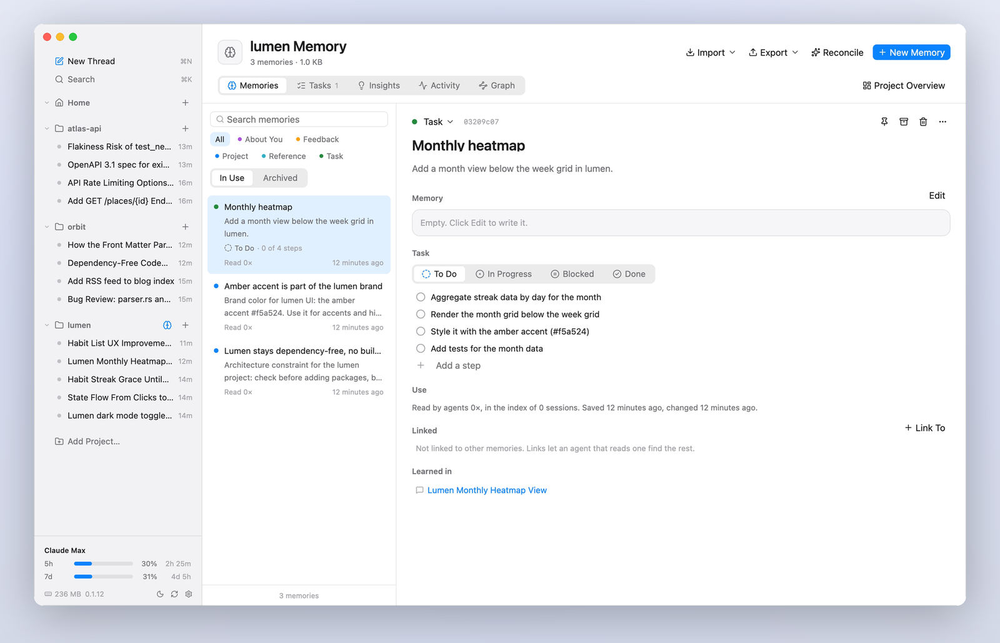
      </picture>
      <h3>Memory that carries over</h3>
      Memories and tasks that agents read and write through their own tools, offered to every session. A board of tasks, insights, activity and a graph; import and export.
    </td>
  </tr>
  <tr>
    <td width="50%" valign="top">
      <picture>
        <source media="(prefers-color-scheme: dark)" srcset="docs/media/spotlight-dark.png">
        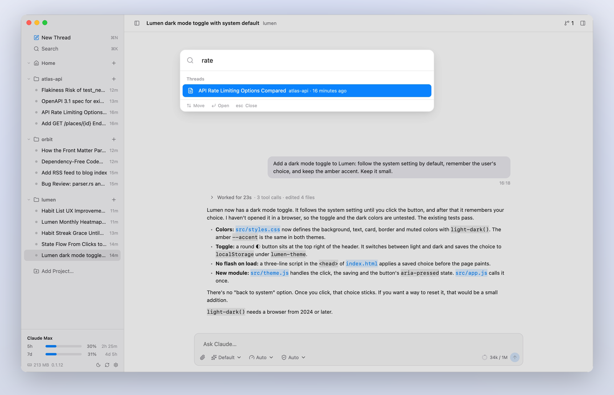
      </picture>
      <h3>Every thread, one keystroke away</h3>
      ⌘K finds any thread in any project, and what was said in it. Each thread runs its own <code>claude</code>: switch freely while they work.
    </td>
    <td width="50%" valign="top">
      <picture>
        <source media="(prefers-color-scheme: dark)" srcset="docs/media/tasks-dark.png">
        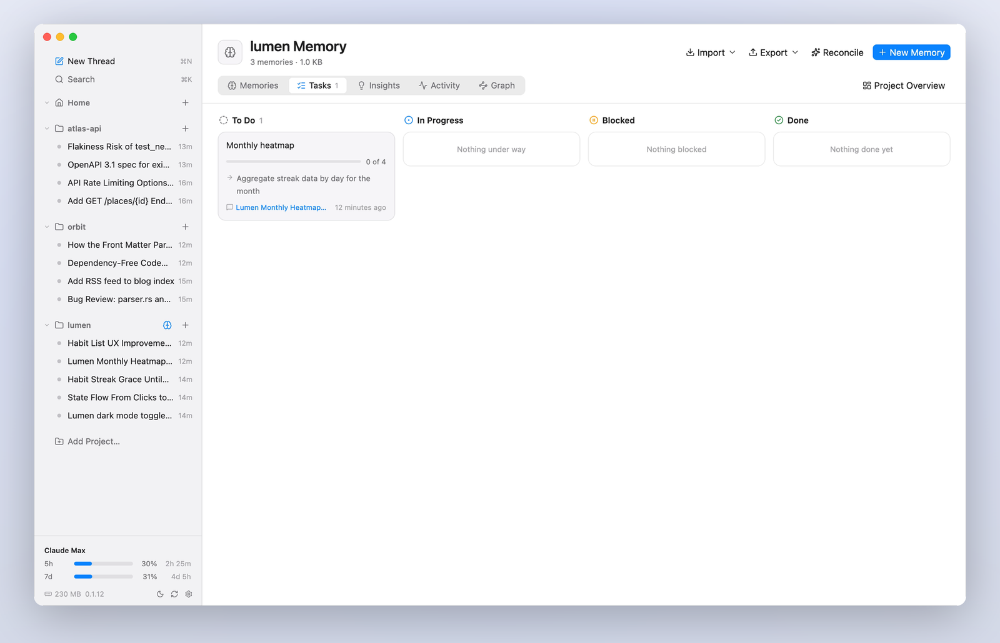
      </picture>
      <h3>Tasks you can follow</h3>
      What you asked for, kept as tasks with steps that agents tick off, so the next session knows where things stand.
    </td>
  </tr>
</table>

And everything else you'd want day to day:

- **Projects and threads.** Local folders as projects, any number of threads each; pin, settle (automatically after idle days) and delete with undo. Resume a Claude Code session started elsewhere.
- **The composer.** Attach files and pictures, mention files with `@`, slash commands and skills, model, effort and permission mode, a context gauge. Queue messages, steer a running turn, or interrupt and send.
- **Cards for what Claude asks.** Permission requests (several at once from parallel sub-agents), questions, plans to approve in a chosen mode, MCP server forms and sign-ins.
- **The right sidebar.** The thread's pull requests and stacks, a side chat that can read the thread without changing it, sub-agents with their commands, the project's files, and the browser.
- **Background work you can see.** Commands and sub-agents left running show where they belong, with what they're doing and a Stop button.
- **Git and code hosting.** Repos and worktrees per project, pull requests and merge requests through `gh` and `glab`, GitHub stacks.
- **Usage and limits.** Your plan's limits in the sidebar, and a usage page by day and model from Claude Code's own history.
- **MCP.** See, add, switch off, reconnect and sign in to the MCP servers your sessions use.
- **Light and dark.** macOS colors in both, following the system or your choice.

## On your iPhone

<p align="center">
  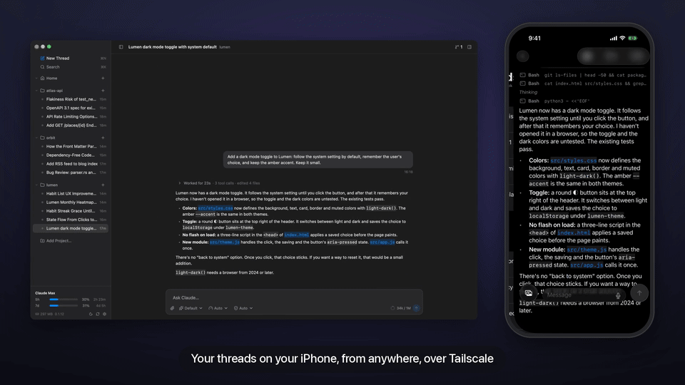
</p>

YourHarness for iPhone and iPad follows and runs your Mac's threads: read the transcript as it streams, send and steer, answer Claude's questions and permission cards, approve plans, start new threads. On the same Wi‑Fi it just connects; with [Tailscale](https://tailscale.com) on both, it reaches your Mac from anywhere, and only your own devices on your tailnet can get in. Pair once by scanning the code in Settings → Phone. The phone app is in beta; see [docs/mobile.md](docs/mobile.md).

## Why it's fast

YourHarness is one native process, drawn with [GPUI](https://www.gpui.rs) (the GPU-accelerated UI framework the Zed editor uses) on Metal. The transcript is a virtualized list that lays out only what's on screen, views that don't change are cached rather than drawn again, and anything slow (git, `gh`, file scans, loading history) runs off the main thread.

Performance is measured, not assumed. `scripts/perf-run.sh` drives the app through scrolling, switching, typing and opening pages while twenty huge threads stream at once, and records frames on time, stalls, CPU, memory and how long clicks take. See [docs/performance.md](docs/performance.md) for the results and the rules that keep it fast.

## Install

Download the latest DMG from [Releases](https://github.com/mdovhopo/yourharness/releases/latest), open it and drag YourHarness to Applications. The app isn't notarized yet, so the first time you open it macOS refuses: go to System Settings → Privacy & Security and choose Open Anyway. Later versions install themselves from the app.

**Requirements**

- macOS 26 or later, on Apple Silicon
- [Claude Code](https://docs.claude.com/en/docs/claude-code) installed and signed in (`claude` on your `PATH`)
- Optional: `gh` and `glab`, signed in, for pull requests; Tailscale, for the phone away from home

## Your data

Everything stays on your Mac, in `~/Library/Application Support/YourHarness`: a SQLite database, attachments and the browser's data. History from earlier versions is read in place and moved forward on first launch. The database format is the one 0.0.x wrote, so an older version can still open it.

## Build & run

You need Rust (CI pins 1.99.1) and Xcode 26 for the macOS SDK.

```sh
export DEVELOPER_DIR=/Applications/Xcode.app/Contents/Developer
cargo build -p yh-app                   # debug build
cargo test -p yh-core -p yh-app         # tests, including the stream parser against captured CLI output
scripts/bundle.sh                       # build/YourHarness Next.app (release, arm64), its own bundle ID
open "build/YourHarness Next.app"
scripts/mobile.sh                       # the phone app, in a Simulator of its own
```

Development copies use their own bundle ID, so they never share permissions with the app you use. [CLAUDE.md](CLAUDE.md) lists the launch options for test runs (scratch data folders, snapshots, probes) and the rules for working on the code. The videos and screenshots above are made from the real app by [scripts/demo](scripts/demo/README.md).

<details>
<summary><b>Releasing</b></summary>

Versions follow [semver](https://semver.org) and live in `VERSION`. Add notes under **Unreleased** in [CHANGELOG.md](CHANGELOG.md) as changes land, then from a clean, up-to-date `main`:

```sh
scripts/release.sh 0.1.0
```

It runs the tests, files the notes under the version, builds, signs and checks the DMG, then tags and pushes. If anything before the push fails, the commit and tag are taken back. The tag's workflow (`.github/workflows/release.yml`) builds the DMG again and publishes the GitHub release.

</details>

<details>
<summary><b>Architecture</b></summary>

```
crates/
  yh-core/   agent-agnostic core, no UI: the Claude Code adapter and stream parser, the SQLite store,
             memory, git and code hosting, markdown, diagrams, the MCP servers given to agents
  yh-app/    the GPUI app: window and sidebar, transcript, composer, right sidebar, pages, the browser
             (WebKit views placed over the window), the updater
mobile/ios/  the phone app (SwiftUI, a UICollectionView transcript)
```

See [docs/architecture.md](docs/architecture.md) for how it fits together, and the other files in [docs/](docs/) for storage, memory, the browser, files, MCP, the phone and design.

</details>

## Changelog

What changed in each version is in [CHANGELOG.md](CHANGELOG.md).
