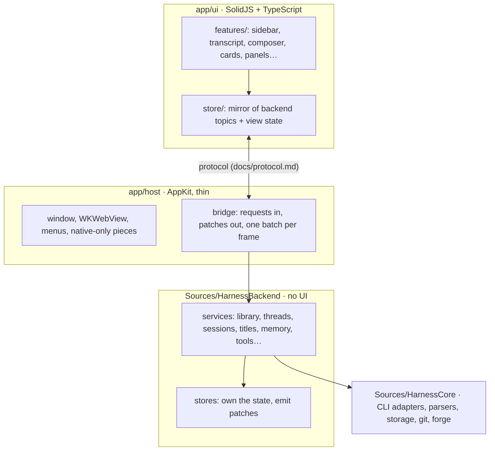

# Architecture and the UI rewrite

The SwiftUI/AppKit app is frozen (tag `swift-app-frozen`, sources in `legacy/`, not built).
Its features are the reference for what the app does, not for how: nothing is ported one for
one. The new UI is web, drawn by one `WKWebView`; why, and the measurements behind it, are in
[web-experiment.md](web-experiment.md). The backend stays Swift for now and is meant to become
Rust later, so everything here keeps the line between the two clean.

## Layers

- **HarnessCore** drives CLIs and stores things. Unchanged by the rewrite but for additions.
- **HarnessBackend** owns everything the app knows: projects, threads, their rows, sessions,
  permissions, queued messages, plans, settings. It has no UI imports and talks only in the
  protocol: **requests** in (send, allow, rename…), **patches** out (what changed). It's the
  one place state changes, so saving, search, the tools agents call and the screen all see the
  same thing. This is what Rust replaces later.
- **app/host** is as small as it can be: the window, the web view, menus, and what only native
  code can do (agents' browser views, Quick Look, file pickers, notifications, Dock badge). It
  carries the protocol between page and backend, batching patches to one delivery a frame.
- **app/ui** shows the backend's state and keeps only view state of its own (scroll positions,
  what's open, hover, drafts until sent). It never works out domain state from raw events.

## The protocol

One contract, written down in [protocol.md](protocol.md), with types on both sides
(`app/ui/src/protocol.ts`, `Sources/HarnessBackend/Protocol*.swift`) checked against the same
recorded messages in tests. Rules that keep it scalable:

- **Topics, not screens.** State is split into topics (`library`, `thread/<id>`, `settings`,
  `usage`…). The page subscribes to what's on screen and unsubscribes when it isn't, so a
  hundred threads cost nothing until opened.
- **Patches carry revisions.** Each topic has a revision; a patch says which it applies to. A
  page that missed one asks for a snapshot. Big things (history pages, file contents) are
  fetched, not pushed.
- **Requests are intents** ("send this", "allow that"), never "set field X". The backend
  decides what changes and says so in patches.
- **No language in the wire.** Plain JSON, short stable keys, no Swift or JS types in it, so a
  Rust backend speaks it unchanged.

## What we learned that the UI must keep

From the experiment (details in web-experiment.md):

- One batch of patches per display frame, never while the page is still taking the last.
- Rows redraw one at a time: each has its own version; streamed text changes a row in place.
- Only the newest rows of a thread are held; earlier pages are fetched while you scroll up.
  Transcripts you leave are parked (no redraw) and let go of after a few.
- Off-screen rows skip layout (`content-visibility: auto`); the transcript follows the end in
  the same frame it grows and keeps your place when rows above change.
- **No box that scrolls inside a row.** WebKit gives each its own layer: three times the
  memory and 90 ms frames. Code wraps. One scroller per column.
- WebKit's 60 Hz default is turned off (`PreferPageRenderingUpdatesNear60FPSEnabled`).
- Animate only opacity and transform; no layout-changing hover.

## Plan

Each chunk ends with the perf run (`scripts/perf-run.sh`) against the last chunk's numbers, a
live Haiku turn, and a push to `rewrite`. Nothing is released from `rewrite` until it's the
whole app; the user's app stays the frozen 0.0.16 until then.

| Chunk | What | Status |
|---|---|---|
| 0 | Repo on the new stack: layout, frozen legacy, docs, scripts, store experiment kept | done |
| 1 | **Backend owns threads.** Projects and threads from the app's own `harness.sqlite` (the user's data, same folder, same format), thread runtime (sessions, resume, idle reap, saving rows as they change, crash recovery), the protocol with topics and revisions. UI: sidebar with pin, settle, rename, delete, new thread; transcript; composer with model, effort and mode from the CLI's catalog; queue and steer; stop; permission, question and plan cards. Crash recovery, queued messages, unread. | done |
| 2 | Transcript parity: markdown details, Edit diffs, sub-agent cards, plan checklist, notices and compaction, slash commands, @ mentions, images and files in messages, find in thread. | done (markdown polish ongoing) |
| 3 | App shell: titles (generated, renamed), notifications and badge, Home project, ⌘K search, settings, usage limits, resume a Claude Code session. | done |
| 4 | Agents' tools served by the backend: memory, threads, and their views (Memory page, tasks). | |
| 5 | Right sidebar: side chat, sub-agents, files, pull requests and workspaces, the agents' browser (native views placed by the page). | |
| 6 | The rest: usage view, MCP sheet, state export and import, updater, release pipeline; then the switch. | |
