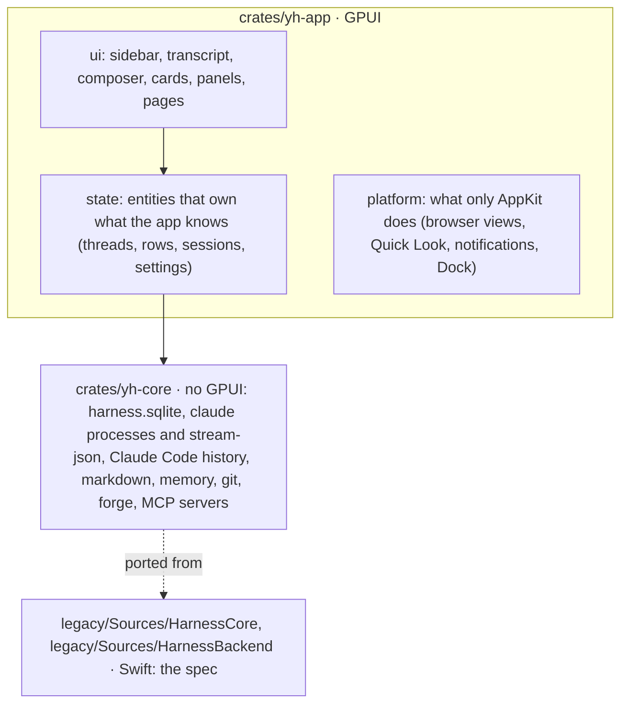

# Architecture and the rewrite

The SwiftUI/AppKit app is frozen (tag `swift-app-frozen`, sources in `legacy/YourHarness`, not
built). Its features are the reference for what the app does, not for how. The app is being
rewritten **in Rust on GPUI**, Zed's GPU-drawn UI framework, as one process. Why: under 20
threads streaming at once, GPUI was the only stack that held 99% of frames on time, at about
160 MB (docs/gpui-experiment.md). A web UI was tried first (docs/web-experiment.md, and the
work in `legacy/web`, `legacy/Sources/HarnessBackend`). That work is superseded, but it's kept as a
reference: its protocol, stores and features describe the same app.

## Layers

- **yh-core** is everything that isn't drawing, with no GPUI: storage, `claude` processes and
  their stream-json parsing, Claude Code's session files, markdown, memory, git and forge
  clients, and the MCP servers agents call. It's testable on its own (`cargo test -p yh-core`).
  Long or blocking work runs on background threads and hands results back through channels.
- **yh-app/state** owns what the app knows, as GPUI entities with no rendering: the library
  (projects, threads), each thread's rows and runtime (session, queue, permissions, plans),
  settings. Every change goes through it, so saving, search, agents' tools and the screen all
  see the same thing. Changes notify the entities that care. Nothing is computed in a view.
- **yh-app/ui** draws state and keeps only view state (scroll positions, what's open, hover,
  drafts until sent).
- **yh-app/platform** is the AppKit edge: windows GPUI doesn't own, agents' browser views
  (WKWebView over the GPUI window), Quick Look, notifications, the Dock badge.

**Data stays the user's.** `harness.sqlite` keeps the Swift app's format (docs/storage.md):
same tables, same JSON in `projects` and `threads`, rows in `entries`, big tool output in
`blobs` (LZFSE). The rewrite reads the user's existing data and writes what the Swift app can
still read, until the switch.

## What we learned that the app must keep

From the experiments (details in gpui-experiment.md):

- **The transcript is GPUI's `list`, bottom-aligned**, so it follows the end. Rows are measured
  once and again only when spliced: a streamed delta re-measures exactly the row it changed.
  Off-screen rows cost nothing.
- **Cache views that change rarely** (`AnyView::cached`): the sidebar redraws only when told
  to. A frame under streaming draws the transcript and little else. A view that grows (the
  composer with its cards) isn't cached, because a cached view needs a fixed size.
- **Claude's events are parsed off the main thread.** The main thread takes what's arrived at
  most once a frame (8 ms), with consecutive deltas of a block joined.
- **Hold little.** Keep the newest 160 rows of a thread, and read earlier pages while
  scrolling up. Six transcripts stay made for going back and forth. A running thread nobody
  is looking at keeps its newest 300 rows.
- **Nothing that changes often in a view that's always there**, and nothing slow on the main
  thread from a click: answer the click in the next frame and do the work after.
- **Events into GPUI dispatch synchronously.** Never send one to the window from inside an
  entity update, because it re-enters.
- **Test runs hold off App Nap.** A background app nobody watches gets its timers and display
  link slowed down, which looks exactly like a frozen app.

## Plan

Each feature ends with a live Haiku turn that uses it, checked, and a push to `rewrite`. Full
perf runs (`scripts/perf-run.sh`) are kept for the end of big chunks: one more at most, and one
when the rewrite is whole. Nothing is released from `rewrite` until it's the
whole app; the user's app stays the frozen 0.0.16 until then. The web rewrite's chunks 1–4
(`legacy/Sources/HarnessBackend`, `legacy/web`) are the closest spec for chunks 1–4 here.

| Chunk | What | Status |
|---|---|---|
| 0 | Repo on the new stack: Cargo workspace (`yh-core`, `yh-app`), GPUI through gpui-kit with gpui-component, patches, scripts (bundle, perf, limits), docs; the POC as the starting point | done |
| 1 | **The app owns threads.** Read and write `harness.sqlite` in the Swift app's format (projects, threads, rows, blobs), the user's data folder. Thread runtime: sessions, resume, idle reap, saving rows as they change, crash recovery. Sidebar: pin, settle, rename, delete, new thread. Composer: model, effort and mode from the CLI's catalog; queue and steer; stop. Permission, question and plan cards. Unread. | done |
| 2 | Transcript parity: markdown details (tree-sitter code, tables, links), Edit diffs, sub-agent cards, plan checklist, notices and compaction, slash commands, @ mentions, images and files in messages, find in thread. | done |
| 3 | App shell: titles (generated, renamed), notifications and badge, Home project, ⌘K search, settings, usage limits, resume a Claude Code session. | done |
| 4 | Agents' tools served by the app: memory and thread MCP servers, their views (Memory page, tasks). | done except Memory's insights, graph, import, export and reconciler (chunk 6) |
| 5 | Right sidebar: side chat, sub-agents, files, pull requests and workspaces, the agents' browser (a WKWebView placed over the GPUI window). | PRs (a thread's), side chat, sub-agents, files done; left: stacks graph, workspaces overview, browser |
| 6 | The rest: usage view, MCP sheet, state export and import, updater, release pipeline; then the switch. | |
