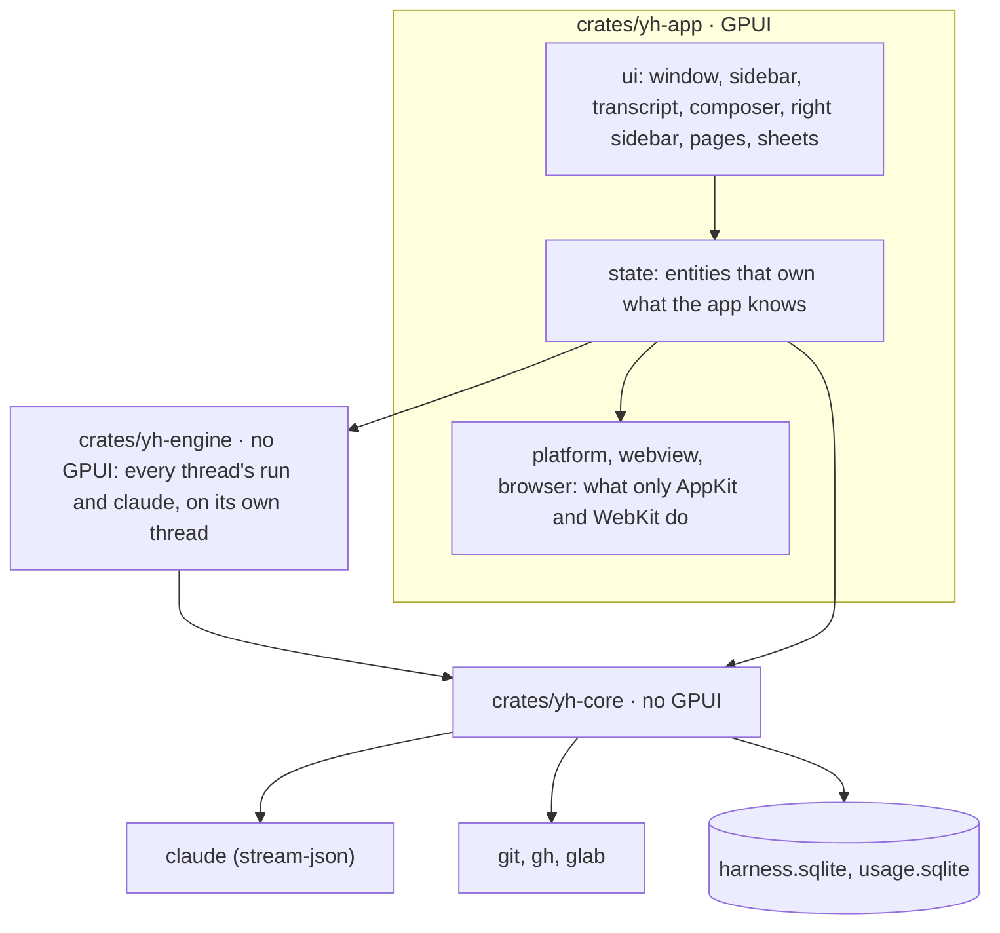

# Architecture

YourHarness is one native process, written in Rust on **GPUI**, Zed's GPU-drawn UI framework.
It drives the official `claude` CLI, one process per thread, and serves that process tools of
its own. GPUI is there for frames: with 20 huge threads streaming at once the app keeps 95–99%
of frames on time at about 200 MB (docs/performance.md).

## Crates

- **yh-core** is everything that isn't drawing, with no GPUI, testable on its own
  (`cargo test -p yh-core`):
  - storage: `db.rs`, `schema.rs`, `library.rs` (projects and threads), `legacy_import.rs`
    (data from 0.0.6 and earlier), `state_archive.rs` (`.yhstate` export and import);
  - Claude Code: `claude.rs` (the process and its stream-json), `thread_run.rs` (a thread's
    events made into rows and live state, told as `RowChange`s; `golden.rs` checks it against
    the recorded sessions), `jobs.rs`, `history.rs` (its session
    files), `recovery.rs` (a turn cut off by a quit or crash), `titles.rs`, `limits.rs`,
    `accounts.rs` (several Claude subscriptions, one `CLAUDE_CONFIG_DIR` each, one per thread),
    `usage.rs`, `plan.rs`, `subagent_record.rs`;
  - what's drawn from text: `markdown.rs`, `links.rs`, `diagrams/` (Mermaid laid out into
    plain geometry), `find.rs`, `clock.rs`;
  - memory: `memory.rs`, `memory_tools.rs`, `memory_agents.rs`, `memory_archive.rs`,
    `memory_stats.rs`;
  - git and forges: `git.rs`, `github.rs`, `gitlab.rs`, `forge.rs`, `stacks.rs`,
    `workspace.rs` (a project's repos, worktrees and PRs), `footprint.rs`, `turn_changes.rs`;
  - the rest: `mcp.rs` (the in-app MCP servers' plumbing), `files.rs`, `attachments.rs`,
    `cookies.rs`, `dev_servers.rs`, `agents.rs`, `shell_env.rs`, `updates.rs`.

  Long or blocking work runs on background threads and hands results back through channels.
- **yh-engine** runs every thread's `ThreadRun` and its `claude` on a thread of its own: the
  app sends it `Command`s (send, stop, allow…) and applies the `ThreadUpdate`s it gets back, at
  most once a frame. It asks the app how to start a `claude` when one is needed
  (`NeedsLaunch`), lets idle ones go, and saves rows (docs/remote.md).
- **yh-app/state** owns what the app knows, as GPUI entities with no drawing. `workspace.rs`
  holds projects, threads, the selection, each thread's `claude` and every request the UI makes
  (send, stop, allow, pin, rename, settle…), and tells views what changed with
  `WorkspaceEvent`s and `notify`. `thread.rs` holds a thread's rows, built from what its `ThreadRun` tells; `pulls.rs`, `jobs.rs`,
  `limits.rs`, `notify.rs`, `updater.rs` and `file_watch.rs` the rest. The tools the app serves
  to agents live here too (`thread_tools.rs`, `harness_tools.rs`). Every change goes through
  state, so saving, search, agents' tools and the screen all see the same thing. Nothing is
  computed in a view.
- **yh-app/ui** draws state and keeps only view state (scroll positions, what's open, hover,
  drafts until sent): `root.rs` (the window and the transcript deck), `sidebar.rs`,
  `transcript.rs` and `rows.rs`, `composer.rs` (with the permission, question and plan cards),
  `inspector.rs` (the right sidebar: PRs, side chat, sub-agents, files, browser), the pages
  (`project.rs`, `memory.rs`, `usage.rs`, built from `page_kit.rs`), `settings.rs`,
  `spotlight.rs` (⌘K), `mcp.rs` (`/mcp`), `menus.rs`, and sheets and smaller views.
- **yh-app's AppKit edge**: `platform.rs` (the NSWindow, real events sent to it, the screen's
  refresh rate, memory and CPU, whether a run can be trusted), `webview.rs` (WKWebViews laid
  over the GPUI window), Quick Look, notifications, the Dock badge, `keep_awake.rs`,
  `video_thumb.rs`. `probe.rs` is the performance run.
- **GPUI** comes through gpui-kit (GPUI 0.3.11 and gpui-component): inputs, selects, popovers,
  dialogs, tables, charts, menus. Three crates are patched (`patches/`, unpacked into
  `vendor/` by `scripts/vendor.sh`); CLAUDE.md says what each patch does.

## Threads and their `claude`

New Thread makes nothing: the thread lives in memory only (`Workspace::pending`, one per
project, not in the sidebar or `harness.sqlite`) until its first message goes, which saves it
(`keep_pending`). Left with nothing typed it's dropped; left with a draft it waits until that
project's next New Thread or the app quits. The phone does the same with a sheet: the Mac makes
the thread only when the phone sends its first message.

A thread that's been talked to has its own `claude` process (`yh_core::claude`), started in
the thread's folder with stream-json in and out, partial messages, the model, effort and
permission mode picked in the composer, and `--resume` with the thread's session once it has
one. Its output is parsed on a reader thread into `Event`s; the main thread takes what's
arrived at most once a frame (8 ms), consecutive deltas of a block joined, and splices exactly
the rows that changed. Permission prompts come as `control_request`s and show as cards above
the composer; questions and plans too. A process with no turn for ten minutes is let go of and
resumed with the next message. A message sent mid-turn steers (joins the turn after the current
step) or queues; Stop interrupts. When the app starts after a crash or a quit mid-turn,
`recovery.rs` fills in what the session file has that the saved rows don't.

Titles are generated by a separate one-shot, tool-less request on Haiku. Side chats and the
memory specialists are sessions of their own, with their own rows.

## The tools the app serves

Claude Code reaches the app's own tools over the stream-json control channel it already has:
the servers are named in `initialize`'s `sdkMcpServers` and called with `mcp_message` control
requests (`yh_core::mcp`), so there's no port, no token, and nothing else can call them.

| Server | What it does |
|---|---|
| `memory` | The workspace's memory: search, read, save, update, link, forget, track tasks. Every call is recorded for the Memory page's activity (docs/memory.md). |
| `threads` | Look through the app's threads (list, read, search), tidy them (rename, settle, pin), bring in Claude Code sessions, and hand work to other threads: `start_thread`, `send_to_thread`, `stop_thread`, `wait_for_threads` (until they finish or need an answer, then their last reply or what they wait on) and `answer_thread` (permissions, questions, plans, MCP questions), taken as the phone's actions are (`take_remote`). Only within the caller's project (Home reaches all); at most 8 threads working per project; a plan is never approved into Bypass. A thread an agent starts records its parent (`parentThreadID` in its record) and sits under it in the sidebar, foldable; its messages from the parent are marked (`agentMessageIDs`), the parent's answers leave a notice, and while the parent's turn runs its requests don't notify you (they do once that turn ends). Against loops: threads two levels down can't start more, each thread starts at most 20, and commands only go down the tree (never to a thread above, nor to another thread's workers). Settings → Delegation turns the control tools off (`agentControlsThreads`, on by default, checked on every call). Nothing can be deleted. |
| `browser` | Drive the thread's browser: open, navigate, snapshot, screenshot, click, type, and the rest (docs/browser.md). |
| `harness` | `sign_in_to_mcp_server`: a card in the thread asks you to sign in to an MCP server Claude needs. |

The names, schemas and replies are the ones agents already use: keep them stable. The thread's
own MCP servers (its `.mcp.json`, your config) are Claude Code's; `/mcp` shows and manages them.

## Storage

Everything is in `harness.sqlite` in the data folder, in the format 0.0.x wrote, so 0.0.16
still opens it after a downgrade; `usage.sqlite` is the usage index. One writer thread, reader
connections of their own, big tool output in `blobs`, a full-text index caught up in the
background. See docs/storage.md.

## The browser

Each thread has its own browser, real WKWebViews (Safari's engine) laid over the spot GPUI
keeps for them, in the right sidebar or in a window of their own; a page nobody shows is parked
off screen. Each project has its own cookie store, so sign-ins stay within it.
The agent drives it through the `browser` tools; you watch, and can take control. See
docs/browser.md, and run `scripts/browser-fidelity/run.sh` after changing it.

## What keeps it fast

These come from measurements (docs/performance.md):

- **The transcript is GPUI's `list`, bottom-aligned**, so it follows the end. Rows are measured
  once and again only when spliced: a streamed delta re-measures exactly the row it changed.
  Off-screen rows cost nothing.
- **Cache views that change rarely** (`AnyView::cached`): the sidebar redraws only when told
  to. A frame under streaming draws the transcript and little else. A view that grows (the
  composer with its cards) is cached at the height it measured.
- **Claude's events are parsed off the main thread**, and applied at most once a frame.
- **Hold little.** A thread holds its newest 160 rows and reads earlier pages while you scroll
  up. Six transcripts stay made for going back and forth; the rest let go of their rows. A
  running thread nobody is looking at keeps its newest 300 rows.
- **Nothing that changes often in a view that's always there**, and nothing slow on the main
  thread from a click: answer the click in the next frame and do the work after.
- **Events into GPUI dispatch synchronously.** Never send one to the window from inside an
  entity update, because it re-enters.
- **Test runs hold off App Nap.** A background app nobody watches gets its timers and display
  link slowed down, which looks exactly like a frozen app.
