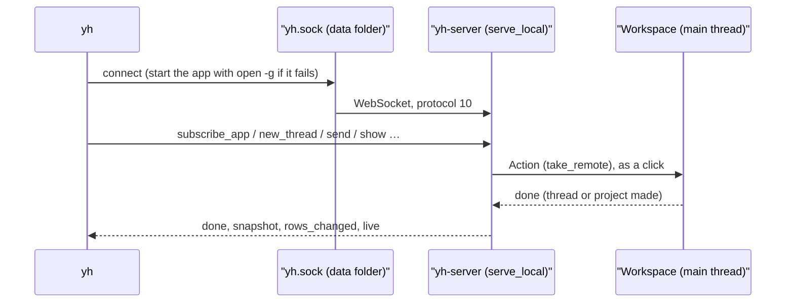

# The command line (`yh`)

`yh` drives YourHarness from a terminal, a script, another app or another agent: start threads
with a prompt and files in any folder, send to them, wait for Claude's reply, answer what they
wait on, and open things in the window. It starts the app when it isn't running.

```sh
yh new "fix the failing test" --wait          # in the current folder's project (added if new)
yh new "review this" -p ~/dev/api -f diff.patch -f shot.png -m sonnet --follow
yh new "tidy the README" --agent antigravity --wait   # on Antigravity (agy), its default model
yh send last "now add a test" --wait
yh threads                                    # ID, state (working, waiting, idle), project, title
yh read 6e53 -n 20
yh allow 6e53                                 # the first permission it waits on
yh open ~/dev/web --draft "look at the login page"   # a new thread there, nothing sent
yh --help
```

- **Projects**: `-p` takes a folder, a project's name or ID. A folder that isn't a project yet
  becomes one (as Add Project does). Without `-p`, `yh` uses the project the current folder is or
  sits inside. A project of your whole home folder only counts when you're in that folder itself.
- **Threads**: an ID, the start of one (4 characters or more), a title, or `last` (the latest
  one worked on).
- **Files** (`-f`, any number) are attached as the composer attaches them: pictures go inline,
  other files and folders by path (small files are copied, as a drop does).
- **Waiting**: `--wait` prints Claude's reply once the turn ends. `--follow` streams it to
  stdout, with tools on stderr. Both stop with exit code 3 when the thread waits on you (a
  permission, a question, a plan) and say what for; `yh allow`/`yh deny` or the app answers, and
  `yh wait THREAD` picks it up again. `--timeout` gives up with exit code 4.
- **`--json`** prints one object per command. With `--follow` you get one object per line:
  `text` deltas, `tool`, `waiting`, `working`, `idle`, then the result. Errors come as
  `{"error", "code"}`. Exit codes: 0 done, 1 failed, 2 wrong usage, 3 waiting on you, 4 timed
  out, 5 the app isn't running (`--no-launch`, `status`).

## Installing

The app carries `yh` in its bundle (`Contents/MacOS/yh`, built by `scripts/bundle.sh`).
Settings → General → Command Line links it into the first of `/opt/homebrew/bin`,
`/usr/local/bin` and `~/.local/bin` that you can write to. It never replaces a `yh` that isn't
YourHarness's, and **Use This Copy** points the link at this copy (stable or Next).
`state/command_line.rs` does this. In development, use `target/release/yh` (`cargo build -p yh-cli`).

## How it works



- The app listens on `yh.sock` in its data folder (`yh_proto::local_socket`, or a socket in
  the temporary folder when that path is too long), mode 0600. The folder is yours and only you
  can open the socket, so it needs no token. `YH_CLI=0` leaves it off. If another copy of the
  app already answers on it (same data folder), this copy leaves it alone.
- The socket speaks the phone's protocol (`yh-proto`, docs/remote.md) through `yh-server`'s
  `serve_local`. Nothing behind it runs until `yh` first connects, and the poller reads nothing
  while no client is connected. So an app nobody drives from the command line pays nothing.
- Protocol 10 adds things only local connections may do: name files on the Mac (`files` on
  `send` and `new_thread`, read in the server's thread), `add_project`, and `show` (the window
  forward, on a thread or a new thread with a draft and files). The network refuses all three.
  `hello` now carries the app's `version`, and projects carry their `path`.
- `yh` picks the data folder by `YH_DATA_DIR` (as the app does) and the app to start by
  `YH_APP`, else the bundle it lives in, else the installed app. It passes its `YH_*` variables
  on to the app it starts. With `YH_APP` it starts a new instance (`open -n`), so a test copy
  never brings forward the copy you have open.

## Testing

`cargo test -p yh-server --test live` covers the socket (`the_local_socket_takes_the_command_lines_actions`).
End to end, use a scratch data folder and a test build, never your real data:

```sh
APP="$PWD/test-harness-root/cli-test/app/YourHarness Next.app" FEATURES=snapshots scripts/bundle.sh
export YH_DATA_DIR=<scratch clone> YH_APP="$PWD/test-harness-root/cli-test/app/YourHarness Next.app" \
       YH_PATH="$PATH" YH_BACKGROUND=1 YH_NOTIFICATIONS=log
target/release/yh new "Use Bash to run: touch x" -m haiku --mode ask --wait   # exit 3, waiting
target/release/yh allow last && target/release/yh wait last
YH_SNAPSHOT=/tmp/open.png YH_SNAPSHOT_DELAY=8 target/release/yh open <folder> --draft hi -f <file>
```

Stop the test copy by its pid (`ps -axo pid,comm | grep cli-test`). It has the same bundle ID as
your Next copy, so never quit it by name.
