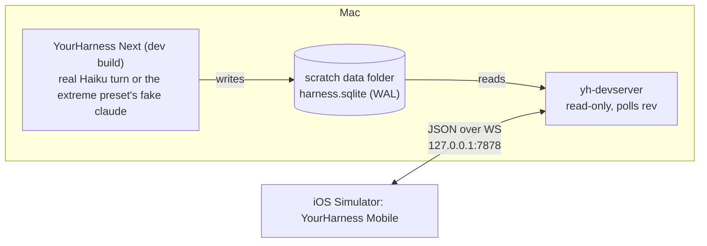

# Mobile: the phone app

Status: the MVP works locally, on the `remote-foundation` branch (the `mobile` branch merged
into it; the foundation's thread carries both). Nothing here is merged into `main`.

**What works (checked 2026-11-09 in the Simulator with real Haiku turns):** the Mac's threads
and transcripts live; sending from the phone, steering, stopping; permission and plan cards
answered from the phone; Claude's reply streaming in word by word as the Mac's Claude Code
writes it; "working" and "waiting on you" in the list.

## The MVP goal

**An iPhone app, running in the Simulator, that shows the Mac's threads and transcripts live.**

- Local network only. The Simulator shares the Mac's network, so it reaches the Mac at
  `127.0.0.1`. No Tailscale, no pairing yet: Tailscale is the last step, once everything
  else works (see [Post-MVP](#post-mvp)).
- It started read-only, over a development server that read the database; acting and
  streaming came with the foundation's engine and server ([remote.md](remote.md)), which the
  phone now uses.
- Performance and iOS-quality design count from the first screen, as they do on the Mac.

## How it got data before the foundation landed (history)

This server is gone: `yh-server` replaced it, inside the Mac app, speaking the same messages
plus live state, actions and streaming (see [The server](#the-server) below).

A small development server, **`yh-devserver`** (`crates/yh-devserver`), reads a data folder's
`harness.sqlite` read-only and serves it over a WebSocket. The app writes the database as it
works (a running turn's rows at least once a second), and every row write bumps the `rev`
counter, so the server polls `max(rev)` and sends the rows that changed.



- **Never the real data folder.** Like every development run, it points at a scratch folder
  (a `cp -c` clone of a preset), and opens it read-only anyway.
- **What it can't know:** `running` and "waiting on you" live only in the app's memory. The
  MVP shows a thread as active when its rows changed in the last few seconds.
- **Granularity:** text arrives in the chunks the app saves (about once a second), not token
  by token. The foundation's `TextAppended` change brings real streaming.
- **It is temporary.** Its messages use the names and shapes [remote.md](remote.md) plans for
  `yh-proto` (`ThreadUpserted`, a thread snapshot, row changes), so moving the app to
  `yh-server` later changes the address, not the app. When `yh-proto` exists, the dev server
  uses its types or goes away.

### The wire (MVP)

JSON text frames, one message each, tagged with `type`. Unknown types and fields are ignored
on both sides.

| Direction | Message | What it carries |
|---|---|---|
| server → app | `hello` | protocol version, server name, data folder name |
| app → server | `subscribe_app` | — |
| server → app | `threads` | every project and thread (id, title, project, updated, pinned, settled) |
| server → app | `thread_upserted` / `thread_removed` | one thread changed or went away |
| app → server | `subscribe_thread { thread, limit }` | the thread to watch (one at a time in the MVP) |
| server → app | `snapshot { thread, first_seq, count, rows }` | the newest `limit` rows |
| server → app | `rows_changed { thread, rows }` | rows added or changed since the last poll, by `seq` |
| app → server | `page { thread, before_seq, limit }` | earlier rows, answered with `page_rows` |

Rows carry the `entries` columns the phone draws: kind, text, tool name, a trimmed tool input
and result (the full result stays on the Mac), error, notice style, date, turn end, changed
files. Sub-agent records are left out of the MVP.

## The app

- **Stack:** native iOS 26, SwiftUI for everything but the transcript, which is a
  `UICollectionView` (the Mac taught us that a SwiftUI lazy list pinned to the bottom stutters
  under streaming). Liquid Glass and native navigation come with SwiftUI.
- **Client:** plain Swift for the MVP: `URLSessionWebSocketTask` and `Codable`. The shared
  Rust client core (`yh-client` through UniFFI, also the way to Android) is a post-MVP
  decision, taken when offline caching or Android makes it pay. The wire is the contract, so
  the client can be swapped without touching the views.
- **Where:** `mobile/ios/`, the Xcode project generated by XcodeGen from `project.yml` (the
  `.xcodeproj` isn't committed), bundle ID `com.mdovhopo.yourharness.mobile`, no third-party
  packages.
- **Screens:**
  1. **Connect:** the server address (`ws://127.0.0.1:7878` by default, or `YH_SERVER` at
     launch), connection state, retry with backoff.
  2. **Threads:** grouped by project, newest first, pinned on top, settled folded away; title,
     time, and a live dot when rows are changing.
  3. **Transcript:** user messages, Claude's replies as markdown (headings, lists, code blocks,
     inline code, links), thinking folded, each tool call one line (name, target, failed),
     notices; follows the bottom while you're there, earlier pages as you scroll up.
- **Rules carried over from the Mac:** changes applied at most once a frame, splicing only the
  rows they touch; markdown parsed off the main thread and cached per row; only recent rows
  held; nothing that changes often in a view that's always there.
- **Rows are measured, not self-sized** (`RowLayout.swift`, `TranscriptLayout.swift`): each copy
  of a row is styled and measured once, in the background, into a height and the frames of its
  pieces; the layout stacks those heights (a running sum, a binary search for what's on
  screen) and cells only set frames. A page of earlier rows is measured before it's inserted,
  so the scroll position is corrected exactly. The first version (compositional layout with
  estimated heights, Auto Layout cells) spent 40% of the main thread solving sizes while
  scrolling.

## Milestones

| | What | Done when |
|---|---|---|
| ✅ **M0** | `yh-devserver`: the wire above, read-only, polling `rev`; tests against a temp database | `cargo test -p yh-devserver`; a WebSocket client sees rows arrive while a dev app runs a Haiku turn on the same scratch folder |
| ✅ **M1** | App skeleton: XcodeGen project, connection, thread list live | Simulator screenshot shows the preset's threads; a new thread made on the Mac appears |
| ✅ **M2** | Transcript: `UICollectionView`, row kinds, markdown, follow-bottom, paging | A Haiku turn on the Mac shows up on the phone as it runs, checked by screenshots |
| ✅ **M3** | Speed and polish: the extreme preset's 20 huge threads, light and dark, Dynamic Type, VoiceOver names | No hitches in Instruments while a 32,000-row thread updates; a design pass |

M0 to M2 were checked on 2026-11-09 with real Haiku turns in a test copy of the app: the phone
opened the working thread on its own (`YH_SELECT=active`) and drew the reply as it grew, about
once a second, following the bottom. `cargo run -p yh-devserver --example watch` prints what the
phone gets, one line a message.

M3, measured in the Simulator (iPhone 17 Pro, 60 Hz) on the extreme preset:

| | Before (self-sizing cells) | After (measured rows) |
|---|---|---|
| Flinging up through "Huge 02" (32,297 rows), late frames | 8.5% | 1.2% |
| Longest update applied | 45 ms | 5 ms |
| Watching a thread while the Mac streams all 20 | 0.39% late, applies 6–10 ms | 0.17% late (none after opening), applies 3–4 ms |

The Mac app streaming those 20 threads with the dev server reading alongside: 120 fps, 99.4% on
time. Still slow: opening a thread's first frame (about 130 ms, nearly all the navigation push's
own work, first time) and launch (about 100 ms). The Simulator isn't a phone: these need a
check on a real ProMotion iPhone (120 Hz, an 8 ms frame) once there's a signed build.

Test hooks: `YH_PERF=1` prints `PERF` lines every 5 s (frames, late frames, the worst frame,
time spent applying the Mac's changes); `YH_SCROLL_PROBE=<s>` flings the open transcript upward
that long, then prints how far it got; `YH_SELECT_DELAY=<s>` opens `YH_SELECT`'s thread that much
after launch (`OPEN`, `SHOWN` lines). `scripts/mobile.sh --log <file>` keeps what the app prints.
To see where the main thread's time goes: `xcrun xctrace record --template 'Time Profiler'
--device <simulator id> --attach YourHarness --time-limit 15s --output <trace>`. To stream the
20 threads, run the app's perf phase on the same clone: `YH_PERF=<dir> YH_PERF_PHASES=stream-all
YH_NO_CLAUDE=1` with the preset's fake `claude` first in `YH_PATH` (as `scripts/perf-run.sh` does).

## The server

`yh-server` runs inside the Mac app when it's started with `YH_SERVER=<port>`: on `127.0.0.1`
only, with a token (`YH_SERVER_TOKEN`, or made up and printed as `SERVER <url>`). The thread list
comes from the database; a watched thread's rows come from the engine as Claude writes them:
the engine's snapshot when the phone opens a thread, told in order with the changes that follow,
then each changed row, whole, at most every 50 ms. The phone takes them as before (newest `rev`
wins), so streaming needed no new message. `cargo run -p yh-server --example yh -- <url> watch`
prints what a client gets.

### Running it

```sh
scripts/preset.sh extreme                     # or any preset → test-harness-root/<name>
cp -c -R test-harness-root/extreme /tmp/yh-mobile-data
# the Mac app (a test copy, never your real data) with its server:
open -g -n --env YH_BACKGROUND=1 --env YH_DATA_DIR=/tmp/yh-mobile-data --env YH_PATH="$PATH" \
  --env YH_SERVER=7878 --env YH_SERVER_TOKEN=phonetest --stderr /tmp/mac.log "<test app>"
YH_SERVER="ws://127.0.0.1:7878/?token=phonetest" scripts/mobile.sh   # build, boot a Simulator, launch
YH_SELECT=active scripts/mobile.sh --no-build --screenshot /tmp/phone.png
```

Screenshots come from `xcrun simctl io booted screenshot`, which captures the Simulator only
and never asks for screen recording. Never `screencapture`.

## Post-MVP

Recorded here so the MVP stays small. Roughly in order; Tailscale last.

1. ✅ **Acting from the phone** over `yh-server` (protocol 2, the Mac app with `YH_SERVER=<port>`):
   the composer sends, steers into a running turn and stops; your queued messages can be sent
   now or taken back; permission cards are allowed or denied, plans approved or kept; the list
   shows threads working and waiting on you. Checked 2026-11-09 with real Haiku turns in `ask`
   mode, sent from the phone: a Write card allowed from the phone (the file written) and one
   denied (no file, the step marked failed). Not checked by hand yet: stop, send now and
   withdraw (the same path as send). Still answered on the Mac: Claude's questions with choices
   (the protocol has allow or deny only) and MCP servers' questions. Not in the protocol yet: a
   new thread in a project, model, effort and mode. Test hooks: `YH_PHONE_SEND=<text>`,
   `YH_PHONE_ANSWER=allow|deny`, `YH_PHONE_ANSWER_DELAY=<s>` (3), doing what the buttons do;
   `DONE <action>` lines when the Mac answers.
2. ✅ **Real streaming**, true `running` and "waiting on you" state: rows from the engine as
   Claude writes, whole, at most every 50 ms. Checked 2026-11-09: a Haiku reply sent from the
   phone grew paragraph by paragraph on it, in a thread that started empty (which first showed
   a bug: rows arriving with none shown were dropped).
3. **A real phone on the local network:** the server on the LAN with its token,
   found by Bonjour, paired by QR code, the token in the Keychain.
4. **Notifications:** APNs sent straight from the Mac with the app's key (no relay for personal
   use), Allow and Deny on the lock screen, a Live Activity for a running turn. Needs the
   Apple Developer Program account.
5. **Composer extras:** photos and camera, voice, `@` files, slash commands.
6. **Richer transcript:** ✅ a tool row opens in a sheet (an edit as a line diff, a write's
   content, a command and its output, other inputs pretty-printed, the result's first 2000
   characters), thinking opens in full, your messages and replies copy with a long press
   (`YH_OPEN_ROW=<tool name|thinking>` opens the newest such row). Still to come: sub-agents,
   Mermaid, images, full tool output on request (a protocol query), Find, search across
   threads.
7. **Shared Rust client core** (`yh-client`, `yh-ffi` through UniFFI): `yh-core`'s markdown
   so both apps render the same, an offline cache in SQLite; then **Android** in Compose over it.
8. **iPad layout**, widgets, a share extension into a thread, Shortcuts.
9. **Several Macs** in one list.
10. **Tailscale:** the server on the tailnet's addresses, `tailscale whois`, `wss://` with
    `tailscale cert`, as [remote.md](remote.md) plans.

### What the phone needs from the protocol

To raise with the foundation before its F2 settles `yh-proto`:

- **Resume from a cursor (`rev`)** on reconnect, not only a fresh snapshot: a phone
  reconnects constantly.
- **Big tool output trimmed on the wire**, with a query for the rest; thumbnails for images.
- **Uploading attachments**, and **registering a device's push token**.
- **`Attention` with its reason and request id**, so a notification can answer a card
  without opening the app.
- **Answering Claude's questions** (`AskUserQuestion`) with the chosen options, not only allow
  or deny; a **new thread** in a project; **model, effort and mode**.
- If the phone ends up on a Rust client core, typeshare's Swift output isn't needed for it.
