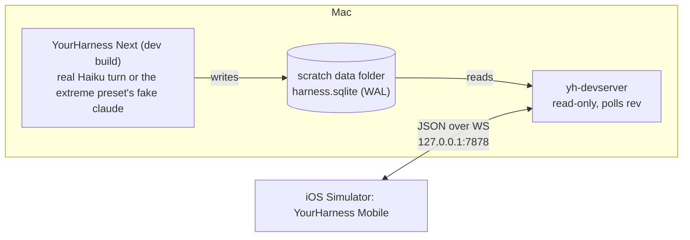

# Mobile: the phone app

Status: the MVP works locally, on the `remote-foundation` branch (the `mobile` branch merged
into it; the foundation's thread carries both). Nothing here is merged into `main`.

**What works (checked 2026-11-09 in the Simulator with real Haiku turns, protocol 4):** sub-agents
as live cards with their runs, pictures (yours and Claude's) and Mermaid diagrams drawn as on the
Mac; and the
Mac's threads and transcripts live, Claude's reply streaming in as the Mac's Claude Code writes
it; sending, steering, stopping; queued messages sent now or taken back; permission cards; Claude's
questions answered (several questions, several choices, or your own words) or skipped; plans
approved into a mode or sent back with feedback; MCP servers' questions accepted or declined;
pictures sent with a message; a new thread in a project; model, effort and the project's
permission mode; rename, pin, settle and bring back, delete; a tool call's whole output; the
phone reconnecting by itself when the Mac app restarts; reaching the Mac over Tailscale from
anywhere (see Tailscale below).

## The MVP goal

**An iPhone app, running in the Simulator, that shows the Mac's threads and transcripts live.**

- Local network only. The Simulator shares the Mac's network, so it reaches the Mac at
  `127.0.0.1`. No Tailscale, no pairing yet: Tailscale is the last step, once everything
  else works (see [Post-MVP](#post-mvp)).
- It started read-only, over a development server that read the database; acting and
  streaming came with the foundation's engine and server ([remote.md](remote.md)), which the
  phone now uses.
- Performance and iOS-quality design count from the first screen, as they do on the Mac.

## How it got data before the foundation landed (history)

This server is gone: `yh-server` replaced it, inside the Mac app, speaking the same messages
plus live state, actions and streaming (see [The server](#the-server) below).

A small development server, **`yh-devserver`** (`crates/yh-devserver`), reads a data folder's
`harness.sqlite` read-only and serves it over a WebSocket. The app writes the database as it
works (a running turn's rows at least once a second), and every row write bumps the `rev`
counter, so the server polls `max(rev)` and sends the rows that changed.



- **Never the real data folder.** Like every development run, it points at a scratch folder
  (a `cp -c` clone of a preset), and opens it read-only anyway.
- **What it can't know:** `running` and "waiting on you" live only in the app's memory. The
  MVP shows a thread as active when its rows changed in the last few seconds.
- **Granularity:** text arrives in the chunks the app saves (about once a second), not token
  by token. The foundation's `TextAppended` change brings real streaming.
- **It is temporary.** Its messages use the names and shapes [remote.md](remote.md) plans for
  `yh-proto` (`ThreadUpserted`, a thread snapshot, row changes), so moving the app to
  `yh-server` later changes the address, not the app. When `yh-proto` exists, the dev server
  uses its types or goes away.

### The wire (MVP)

JSON text frames, one message each, tagged with `type`. Unknown types and fields are ignored
on both sides.

| Direction | Message | What it carries |
|---|---|---|
| server → app | `hello` | protocol version, server name, data folder name |
| app → server | `subscribe_app` | — |
| server → app | `threads` | every project and thread (id, title, project, updated, pinned, settled) |
| server → app | `thread_upserted` / `thread_removed` | one thread changed or went away |
| app → server | `subscribe_thread { thread, limit }` | the thread to watch (one at a time in the MVP) |
| server → app | `snapshot { thread, first_seq, count, rows }` | the newest `limit` rows |
| server → app | `rows_changed { thread, rows }` | rows added or changed since the last poll, by `seq` |
| app → server | `page { thread, before_seq, limit }` | earlier rows, answered with `page_rows` |

Rows carry the `entries` columns the phone draws: kind, text, tool name, a trimmed tool input
and result (the full result stays on the Mac), error, notice style, date, turn end, changed
files. Sub-agent records are left out of the MVP.

## The app

- **Stack:** native iOS 26, SwiftUI for everything but the transcript, which is a
  `UICollectionView` (the Mac taught us that a SwiftUI lazy list pinned to the bottom stutters
  under streaming). Liquid Glass and native navigation come with SwiftUI.
- **Client:** plain Swift for the MVP: `URLSessionWebSocketTask` and `Codable`. The shared
  Rust client core (`yh-client` through UniFFI, also the way to Android) is a post-MVP
  decision, taken when offline caching or Android makes it pay. The wire is the contract, so
  the client can be swapped without touching the views.
- **Where:** `mobile/ios/`, the Xcode project generated by XcodeGen from `project.yml` (the
  `.xcodeproj` isn't committed), bundle ID `com.mdovhopo.yourharness.mobile`, no third-party
  packages.
- **Screens:**
  1. **Connect:** the server address (`ws://127.0.0.1:7878` by default, or `YH_SERVER` at
     launch), connection state, retry with backoff.
  2. **Threads:** grouped by project, newest first, pinned on top, settled folded away; title,
     time, and a live dot when rows are changing.
  3. **Transcript:** user messages, Claude's replies as markdown (headings, lists, code blocks,
     inline code, links), thinking folded, each tool call one line (name, target, failed),
     notices; follows the bottom while you're there, earlier pages as you scroll up.
- **Rules carried over from the Mac:** changes applied at most once a frame, splicing only the
  rows they touch; markdown parsed off the main thread and cached per row; only recent rows
  held; nothing that changes often in a view that's always there.
- **Rows are measured, not self-sized** (`RowLayout.swift`, `TranscriptLayout.swift`): each copy
  of a row is styled and measured once, in the background, into a height and the frames of its
  pieces; the layout stacks those heights (a running sum, a binary search for what's on
  screen) and cells only set frames. A page of earlier rows is measured before it's inserted,
  so the scroll position is corrected exactly. The first version (compositional layout with
  estimated heights, Auto Layout cells) spent 40% of the main thread solving sizes while
  scrolling.

## Milestones

| | What | Done when |
|---|---|---|
| ✅ **M0** | `yh-devserver`: the wire above, read-only, polling `rev`; tests against a temp database | `cargo test -p yh-devserver`; a WebSocket client sees rows arrive while a dev app runs a Haiku turn on the same scratch folder |
| ✅ **M1** | App skeleton: XcodeGen project, connection, thread list live | Simulator screenshot shows the preset's threads; a new thread made on the Mac appears |
| ✅ **M2** | Transcript: `UICollectionView`, row kinds, markdown, follow-bottom, paging | A Haiku turn on the Mac shows up on the phone as it runs, checked by screenshots |
| ✅ **M3** | Speed and polish: the extreme preset's 20 huge threads, light and dark, Dynamic Type, VoiceOver names | No hitches in Instruments while a 32,000-row thread updates; a design pass |

M0 to M2 were checked on 2026-11-09 with real Haiku turns in a test copy of the app: the phone
opened the working thread on its own (`YH_SELECT=active`) and drew the reply as it grew, about
once a second, following the bottom. `cargo run -p yh-devserver --example watch` prints what the
phone gets, one line a message.

M3, measured in the Simulator (iPhone 17 Pro, 60 Hz) on the extreme preset:

| | Before (self-sizing cells) | After (measured rows) |
|---|---|---|
| Flinging up through "Huge 02" (32,297 rows), late frames | 8.5% | 1.2% |
| Longest update applied | 45 ms | 5 ms |
| Watching a thread while the Mac streams all 20 | 0.39% late, applies 6–10 ms | 0.17% late (none after opening), applies 3–4 ms |

The Mac app streaming those 20 threads with the dev server reading alongside: 120 fps, 99.4% on
time. Still slow: opening a thread's first frame (about 130 ms, nearly all the navigation push's
own work, first time) and launch (about 100 ms). The Simulator isn't a phone: these need a
check on a real ProMotion iPhone (120 Hz, an 8 ms frame) once there's a signed build.

Test hooks: `YH_PERF=1` prints `PERF` lines every 5 s (frames, late frames, the worst frame,
time spent applying the Mac's changes); `YH_SCROLL_PROBE=<s>` flings the open transcript upward
that long, then prints how far it got; `YH_SELECT_DELAY=<s>` opens `YH_SELECT`'s thread that much
after launch (`OPEN`, `SHOWN` lines). `scripts/mobile.sh --log <file>` keeps what the app prints.
To see where the main thread's time goes: `xcrun xctrace record --template 'Time Profiler'
--device <simulator id> --attach YourHarness --time-limit 15s --output <trace>`. To stream the
20 threads, run the app's perf phase on the same clone: `YH_PERF=<dir> YH_PERF_PHASES=stream-all
YH_NO_CLAUDE=1` with the preset's fake `claude` first in `YH_PATH` (as `scripts/perf-run.sh` does).

## The server

`yh-server` runs inside the Mac app when it's started with `YH_SERVER=<port>`: on `127.0.0.1`
only, with a token (`YH_SERVER_TOKEN`, or made up and printed as `SERVER <url>`; `YH_SERVER_NAME` names
it for phones, so two test copies on one Mac tell apart). The thread list
comes from the database; a watched thread's rows come from the engine as Claude writes them:
the engine's snapshot when the phone opens a thread, told in order with the changes that follow,
then each changed row, whole, at most every 50 ms. The phone takes them as before (newest `rev`
wins), so streaming needed no new message. `cargo run -p yh-server --example yh -- <url> watch`
prints what a client gets.

### Running it

```sh
scripts/preset.sh extreme                     # or any preset → test-harness-root/<name>
cp -c -R test-harness-root/extreme /tmp/yh-mobile-data
# the Mac app (a test copy, never your real data) with its server:
open -g -n --env YH_BACKGROUND=1 --env YH_DATA_DIR=/tmp/yh-mobile-data --env YH_PATH="$PATH" \
  --env YH_SERVER=7878 --env YH_SERVER_TOKEN=phonetest --stderr /tmp/mac.log "<test app>"
YH_SERVER="ws://127.0.0.1:7878/?token=phonetest" scripts/mobile.sh   # build, boot a Simulator, launch
YH_SELECT=active scripts/mobile.sh --no-build --screenshot /tmp/phone.png
```

Screenshots come from `xcrun simctl io booted screenshot`, which captures the Simulator only
and never asks for screen recording. Never `screencapture`.

### Phones on this network (pairing)

Settings → Phone on the Mac: **Let phones connect** (saved as `phonesEnabled`) starts a second
server on every network address, stopped again when it's turned off. Its port is 47878 (unassigned at
IANA, no known app's default; 7878, the first choice, is registered to Opswise and is Radarr's
default), 7878 on a Mac whose phones paired with 0.1.3; when it's taken the next nine are tried, and
the one it got is kept (`phonesPort`) and carried in the pairing link. `YH_PHONES_PORT` for tests.
It shows the Mac's address and a QR code of a pairing link,
`yourharness://pair?host=<ip>&port=<port>&code=<code>&name=<Mac>`. The code is random, works
once, for 10 minutes; New Code replaces it. A phone connects with `?pair=<code>&device=<name>`,
the server answers `hello` then `paired` with a token of the phone's own, and the phone keeps
`ws://<ip>:<port>/?token=<token>` from then on. The Mac keeps only each token's SHA-256
(`phoneDevices`), lists the phones paired with when each was last seen, and Forget ends a phone's
connection and its token. The phone pairs by scanning the code with the Camera app (it opens
`yourharness://`), with Scan the Mac's Code in the app (VisionKit), or by pasting the link on the
Macs page; a new install starts on Pair with Your Mac. A used or old code says Couldn't Pair and
leaves an earlier pairing with that Mac as it was. Each Mac has a lasting ID (`macID`, kept with its data),
sent in `hello` and in the pairing link (`&id=`): the phone keeps one entry per Mac, so pairing again
or reaching it at a new address replaces the old one, and two saved entries that turn out to be the
same Mac (Macs saved before the ID) become one when it connects. The phone has one too (`phoneID`,
sent as `device_id` when pairing): the Mac replaces that phone's entry instead of adding one. Checked:
the same Mac paired again on another port, then twice, left one entry on each side. A thread made from the phone (its project's ✎ opens a sheet for
the first message; nothing is made until it's sent) isn't opened on
the Mac: the Mac stays on what you have open, the new thread in its sidebar with an unread dot. Plain
WebSocket on the Wi‑Fi (not encrypted); over Tailscale, WireGuard encrypts it.

### Tailscale

With Tailscale connected on the Mac (`yh_server::tailscale`: the CLI's `status --json`, read off the
main thread at start and every 15 s while phones may connect), the pairing link and every `hello`
carry `hosts`: the Mac's Wi‑Fi addresses, then its MagicDNS name (`mac.tailXXXX.ts.net`; the 100.x
address only when MagicDNS is off). The phone keeps a Mac's hosts with it (`Saved.hosts`, updated by
each `hello`, so phones paired before learn the tailnet name the first time they connect on Wi‑Fi)
and on every connect opens a socket to each at once, keeping the first to say `hello`; the Macs page
shows the address in use with "· Tailscale". **Why the name, not the address:** iOS's App Transport
Security counts only private ranges as local, not the tailnet's 100.64/10 (plain `ws://` to it
fails with -1022), and an ATS exception can't name an IP, so the app has an exception for `ts.net`
and its subdomains; WireGuard already encrypts that way. `wss://` with `tailscale cert` would need
the tailnet's HTTPS turned on: later, if ever needed.

The server listens on every address as before (only the tailnet's, `100.x`, with **Over Tailscale
only** in Settings → Phone, saved as `phonesTailscaleOnly`; it follows the address when Tailscale
comes back, and waits while it's down). A connection from the tailnet's ranges is checked with
`tailscale whois` before its token: only devices logged in as the Mac's own tailnet user get in,
others get 403 ("This device isn't logged in to Tailscale as you."). Over Tailscale only, anything
off the tailnet is refused too. Test hooks: `YH_TAILSCALE=0`, `YH_TAILSCALE_STATUS=<status.json>`,
`YH_TAILSCALE_WHOIS=<{"<ip>": user id}>`, `YH_PHONES_TAILSCALE_ONLY=1` (not saved). The phone prints
`ROUTE <Mac> via <host>` and `CONNECT <host> failed: …` for each try that didn't work.

Checked 2026-11-10 against this Mac's tailnet: the Simulator paired from a link whose Wi‑Fi address
was dead (`10.255.255.1`) plus the `ts.net` name, over Tailscale, and showed the threads; the `yh`
client paired over `100.78.55.9` (`whois` saying it's you), was refused with a faked other user,
and still got in over Wi‑Fi; Over Tailscale only listened on `100.78.55.9` alone (Wi‑Fi refused)
and a Haiku turn sent over the `ts.net` name streamed its reply back. Checked by the user the same
day with 0.1.4: the real iPhone on cellular, the Mac on Wi‑Fi, end to end.

Test hooks: `YH_PHONES=1` (on at launch, not saved), `YH_PHONES_LOG=1` (prints `PHONES pair
<link>`), `YH_PHONES_BIND=127.0.0.1` (listens on loopback only: with the Mac's firewall on, listening
on the network asks to accept incoming connections, which a test must never put on screen; this
Mac's firewall is off, so the tests here used the network address), `YH_SETTINGS_TAB=phone`; on the
phone `YH_PHONE_PAIR=<link>` (paired with at launch, as opening the link does; `simctl openurl`
puts an "Open in YourHarness?" alert up instead). Checked 2026-11-09: the QR code decodes to the
link (CoreImage's detector); the Simulator paired over 192.168.50.73, reconnected with its token
after a restart, got Couldn't Pair for the used code with the earlier pairing kept; the Mac listed
it after a restart. Server test: `a_phone_pairs_with_a_code_and_is_cut_off_when_forgotten`.

### Pull requests

Each project's header on the phone has a PR button (projects with no threads show too, as on the
Mac). It asks the Mac `pulls` (protocol 5), which reads the project's repos' open PRs as its project
page does (`yh_core::workspace`, `gh`/`glab`, `YH_MOCK_PULLS` in tests), aside on a thread of its own,
kept a minute (`fresh` asks again; pull to refresh). The sheet lists Needs Your Review, Yours and
Others, each stack together on a rail, with draft, review, conflicts, behind, auto-merge and merge
queue badges and the checks' state; chips filter the sections and drafts (kept between launches).
A PR opens on GitHub; long press copies its link. Hooks: `YH_PHONE_PULLS=<project name>` (its sheet
open; filters reset), `YH_PHONE_PULLS_HIDE=others,drafts`, and `YH_WAIT=<s>` for `yh … raw`. Checked
with mock PRs (a stack of three, one for review, a draft, conflicts, auto-merge) and real `gh`.

### On your own iPhone or iPad

`scripts/mobile-device.sh [device]` builds the app signed with your Apple team, installs it on a
connected device and opens it. Once, before the first run:

1. Xcode → Settings → Accounts → + → Apple ID, and sign in. A free account works (apps signed with
   it run for 7 days, then run the script again); the paid Developer Program's account lasts a year.
2. Select the account, Manage Certificates… → + → Apple Development.
3. Connect the iPhone or iPad by cable, unlock it, tap Trust This Computer.
4. On the device: Settings → Privacy & Security → Developer Mode → on (it restarts).
5. `scripts/mobile-device.sh`. The team comes from your certificate (`TEAM=<id>` to pick one); if
   the bundle ID is taken under a free team, `BUNDLE_ID=com.<you>.yourharness`.
6. First launch: if iOS says the developer isn't trusted, Settings → General → VPN & Device
   Management → your Apple ID → Trust.
7. On the Mac: Settings → Phone → Let phones connect; on the phone: Pair with Your Mac → Scan the
   Mac's Code (allow the camera), then allow Local Network when iOS asks. Both on the same Wi‑Fi.

### TestFlight

`scripts/testflight.sh` archives a Release build signed for distribution (automatic signing,
your team from the Apple Development certificate) and uploads it with the account Xcode is
signed in to, or an App Store Connect API key (`ASC_KEY_ID`, `ASC_ISSUER_ID`, `ASC_KEY_PATH`)
for CI. The version is the repo's `VERSION`, the build number the commit count, so each upload
goes up. Builds are for internal testers only (`testFlightInternalTestingOnly`: no Beta App
Review; external testers would need it, and a reviewer can't use the app without a Mac running
YourHarness). `ITSAppUsesNonExemptEncryption` is false, so no export-compliance question per
build. The icon is Next's (night blue) for local builds and TestFlight; only the App Store build
takes `APP_ICON=AppIcon` (graphite). `DRY=1` stops at the exported `.ipa`. Checked 2026-11-10:
the dry run signs with an App Store profile for `com.mdovhopo.yourharness.mobile`.

## Post-MVP

Recorded here so the MVP stays small. Roughly in order; Tailscale last.

1. ✅ **Acting from the phone** over `yh-server` (protocol 2, the Mac app with `YH_SERVER=<port>`):
   the composer sends, steers into a running turn and stops; your queued messages can be sent
   now or taken back; permission cards are allowed or denied, plans approved or kept; the list
   shows threads working and waiting on you. Checked 2026-11-09 with real Haiku turns in `ask`
   mode, sent from the phone: a Write card allowed from the phone (the file written) and one
   denied (no file, the step marked failed). Stop checked too (a long reply cut off from the
   phone, "Interrupted" on both). Not checked by hand yet: send now and withdraw (the same path). Still answered on the Mac: Claude's questions with choices
   (the protocol has allow or deny only) and MCP servers' questions. Not in the protocol yet: a
   new thread in a project, model, effort and mode. Test hooks: `YH_PHONE_SEND=<text>`,
   `YH_PHONE_ANSWER=allow|deny`, `YH_PHONE_ANSWER_DELAY=<s>` (3), `YH_PHONE_STOP=<s>` (Stop that long
   after the thread starts working), doing what the buttons do;
   `DONE <action>` lines when the Mac answers.
2. ✅ **Real streaming**, true `running` and "waiting on you" state: rows from the engine as
   Claude writes, whole, at most every 50 ms. Checked 2026-11-09: a Haiku reply sent from the
   phone grew paragraph by paragraph on it, in a thread that started empty (which first showed
   a bug: rows arriving with none shown were dropped).
2b. ✅ **The whole app from the phone** (protocol 3), each checked with a real Haiku turn sent
   from the phone: a two-question card with a multi-select answered (`Zed, Vim` and `macOS`
   reached Claude); a plan made in Plan mode set from the phone, approved into Accept Edits (the
   file written, the project's mode changed); an MCP server's form question accepted (a test
   server, `pick_color`, got its default back); a picture read by Claude ("BLUE 42"); model and
   effort set; a queued message removed, another sent now (the command interrupted, the reply
   to it given); a 13,892-character result fetched whole; pin, rename, settle, bring back,
   delete; a new thread from a project's header; the Mac app restarted mid-session, the phone
   back on its own. Test hooks: `YH_PHONE_NEW_THREAD=<text>` (with `YH_PHONE_PROJECT=<name>`; `YH_PHONE_COMPOSE=<draft>` only
   opens the sheet; `YH_PHONE_NEW_MODEL`, `YH_PHONE_NEW_EFFORT` are chosen in either),
   `YH_PHONE_CHOOSE=<label>[,<label>]` (answers Claude's question; `YH_PHONE_ANSWER=deny` skips
   it), `YH_PHONE_PLAN=approve:<mode>|keep:<feedback>`, `YH_PHONE_MCP=accept|decline`,
   `YH_PHONE_SET=model=…,effort=…,mode=…`, `YH_PHONE_QUEUE=<text>` with
   `YH_PHONE_QUEUE_ACTION=now|remove`, `YH_PHONE_PHOTO=1` (a made-up picture with
   `YH_PHONE_SEND`), `YH_PHONE_WHOLE=<seq>`, `YH_PHONE_THREAD_ACTIONS=pin,rename:<title>,settle,unsettle,delete`.
3. ✅ **A real phone on the local network** (2026-11-09): Settings → Phone, paired by QR code, a
   token for each phone (see "Phones on this network"). Still to come: found by Bonjour when the
   Mac's address changes, the token in the Keychain rather than the app's settings, encryption.
4. **Notifications:** APNs sent straight from the Mac with the app's key (no relay for personal
   use), Allow and Deny on the lock screen, a Live Activity for a running turn. Needs the
   Apple Developer Program account.
5. ✅ **Composer extras:** photos (2b), voice (5c), and, with protocol 5, slash commands and `@`
   files: typing `/` lists the project's commands as Claude Code reported them (`/btw` always,
   `/mcp` left out: a Mac sheet), filtered as you type; `@` asks the Mac for files in the thread's
   folder matching what follows. A tap writes it in. Hooks: `YH_PHONE_DRAFT=<text>` (in the field
   at launch; `/` or `look at @no` shows the list), `SUGGEST n: …` lines.
5d. ✅ **Protocol 5, checked 2026-11-09 in the Simulator against the Mac test app**:
   - **The dock** (iOS 26 tab bar): Threads, Usage, Mac (address, status, protocol; what the
     server sheet was) and Search; hidden inside a thread, where the composer is.
     `YH_PHONE_TAB=usage|mac|search`.
   - **Search**, the dock's search tab: titles matched on the phone, then the Mac's full-text index
     ("In Conversations", the words found in bold); a result opens its thread in Threads.
     `YH_PHONE_SEARCH=<words>` (with `YH_PHONE_TAB=search`).
   - **Usage limits** on the Usage tab, not on the thread list; a window whose reset time has
     passed says so instead of showing an old figure as current.
   - **Can't reach your Mac**: until the phone has connected once, an empty state with the
     address, Try Again and Server Settings in place of an empty list.
   - **Side chats** (`/btw`, or the toolbar's bubbles): a sheet with the side chat's rows drawn by
     the same transcript, asked through `ask_aside`; the server follows a `side:<thread>` beside
     the thread a client watches, until the sheet closes (`unsubscribe_thread` with `thread`).
     Checked with a real Haiku turn from the phone. `YH_PHONE_ASIDE=<question>`.
   - **Only the open thread streams.** Measured with `yh <url> listen 40 [thread]` while another
     thread wrote 300 words: a client with only the list open got no rows, 5 status updates
     (1.7 KB); one with the thread open got 62 row updates (63 KB). Each update carries the whole
     growing row; sending only what was appended would cut that, later.
   - **Resuming** after a reconnect: `subscribe_thread` with `known` (the rows held), the snapshot
     starting a little before them, merged by content (a restarted server numbers `rev`s anew),
     so only what changed is drawn again: `RESUME from 0: 0 changed, 2 new` after a Mac restart
     with a turn in between.
   - Found doing it, fixed: a thread the phone opened before the Mac did lost its Claude session
     (the engine made its run for the snapshot with none, then ignored the app's `Open`), so the
     next message started a new conversation and its side chat saw nothing. `Open` now fills in a
     missing session and the app keeps a session it knows (engine test
     `a_snapshot_first_keeps_the_session_the_app_tells`); a phone send after a Mac restart
     resumes the same session.
5b. ✅ **Sub-agents, pictures and diagrams** (protocol 4), checked 2026-11-09 with a real Haiku
   turn sent from the phone: a sub-agent's card updated live ("Working · general-purpose · 1 tool
   use · 30k tokens" and what it was running) and opened a sheet with its status, numbers, what it
   was asked, its steps and report; a picture Claude showed with `show_media` drew in the
   transcript and opened full screen, as did one sent from the phone (from the Mac's attachments
   folder); a Mermaid flowchart in the reply drew as the Mac draws it (the Mac's painter, moved to
   `yh_core::diagrams::paint`, recorded by the server as paths and labels in colour roles) and
   opened at its own size to scroll and zoom. Wide ones too small to read say "Tap to zoom". A kind
   the Mac doesn't draw stays code. Test hooks: `YH_OPEN_ROW=Agent` (the newest sub-agent's sheet),
   `YH_OPEN_PICTURE=1`, `YH_OPEN_DIAGRAM=1`. Links in replies open in Safari on a tap, written
   out web addresses too (the labels don't follow links themselves: `RowCell` finds the one under
   the tap); `YH_OPEN_LINK=1` opens the last one on screen, printing `OPEN link <url>`.
5c. **Voice input** (built 2026-11-09, not yet heard): a mic in the message field, always there;
   tap to dictate (Apple's speech recognition, on the device where it can be), the words written
   into the field after what's there as you speak, tap again (or Send) to stop. Asks for the
   microphone and Speech Recognition the first time. Checked so far: the mic shows and the
   permission is asked with the app's wording. Not checked: words coming in. `simctl` can't grant
   Speech Recognition, so a test can't get past the alert, and a live mic in the Simulator would
   use the Mac's microphone (a macOS prompt). Check it by hand: open the Simulator window, Allow,
   dictate; or on a real iPhone. `YH_PHONE_DICTATE_FILE=<audio>` transcribes a file into the field
   once allowed (`say -o x.aiff "…"` makes one).
6. **Richer transcript:** ✅ a tool row opens in a sheet (an edit as a line diff, a write's
   content, a command and its output, other inputs pretty-printed, the result's first 2000
   characters), thinking opens in full, your messages and replies copy with a long press
   (`YH_OPEN_ROW=<tool name|thinking>` opens the newest such row). Sub-agents, Mermaid, images and
   full output came with protocols 3 and 4, search across threads with 5. Still to come: Find
   in a thread, opening a search hit at its row.
7. **Shared Rust client core** (`yh-client`, `yh-ffi` through UniFFI): `yh-core`'s markdown
   so both apps render the same, an offline cache in SQLite; then **Android** in Compose over it.
8. ✅ **iPad layout** (2026-11-09): the thread list beside the open thread (a split view in the
   Threads tab, when the width is regular; the dock on top), every orientation. Checked on an iPad
   Pro 13" Simulator: `YH_SIM=ipad scripts/mobile.sh …` makes and uses one. Found doing it: the
   thread screen was an empty view until it appeared, and an empty view never appears in a split
   view's detail, so it never opened its thread; it has a base view now. Still to come: widgets, a
   share extension into a thread, Shortcuts.
9. ✅ **Several Macs** (2026-11-09): the phone keeps a list of Macs (`Fleet`, one `Store` each), all
   connected; a Mac not shown gets only its thread list and statuses, so switching is instant and
   the Threads tab's badge counts threads waiting on you on the others. With more than one, the
   Threads title is the Mac shown, inline, its menu listing each Mac with how it's doing ("Connected
   · 1 waiting on you · 1 working") to switch to; the Mac tab lists them (tap to show, swipe to
   forget, add by address). Each Mac keeps its own open thread. Only the Mac shown watches a
   thread: a screen shown again for a moment as a switch takes it down used to pull the thread's
   rows once more. Checked with two Mac test copies (7979, and 7980 named "Mac Studio" with a Write
   card waiting): badge, menu, list; switched mid-run, the first Mac's thread then streamed a reply
   and the phone got none of it (`UNWATCH`, then `rows=0`). Hooks: `YH_SERVER=<a>,<b>` (Macs, not
   saved), `YH_PHONE_MAC=<index>` (shown at launch), `YH_PHONE_SWITCH=<index>` (shown 6 s later),
   `YH_PHONE_ADD_MAC=<address>`; `WATCH`, `UNWATCH` and `MAC` lines.
10. ✅ **Tailscale:** the tailnet's MagicDNS name in the pairing link and `hello`, the phone
    trying every address at once, `tailscale whois`, Over Tailscale only (see Tailscale above).
    `wss://` with `tailscale cert` left for later.
11. ✅ **What's still running:** the open thread's `live` carries `jobs` (background commands,
    long foreground ones, watches, background sub-agents with what each is doing; a running
    sub-agent's own commands as `agent`, counted on its row), shown above the composer as the
    Mac's strip does. Each has `started_at` in whole seconds, so it goes out again only when
    something starts, ends or says something new: the clocks tick on the phone
    (`Text(…, style: .timer)`), and no output is read for the phone. The list gets `jobs` per
    thread (background commands and sub-agents), drawn as an hourglass once its turn is over.
    The app in the background unwatches its thread (and side chat) and picks up from the rows
    held when back (`AWAY`, `BACK` lines), so the Mac streams nothing nobody sees. Checked
    2026-11-10 with a Haiku turn leaving two `sleep`s in the background: hourglass in the list,
    both in the strip with ticking clocks, then the Settings app opened and YourHarness again.

### What the phone needs from the protocol

To raise with the foundation before its F2 settles `yh-proto`:

- ✅ **Resume** on reconnect, not only a fresh snapshot (protocol 5's `known`).
- **Big tool output trimmed on the wire**, with a query for the rest; thumbnails for images.
- **Uploading attachments**, and **registering a device's push token**.
- **`Attention` with its reason and request id**, so a notification can answer a card
  without opening the app.
- **Answering Claude's questions** (`AskUserQuestion`) with the chosen options, not only allow
  or deny; a **new thread** in a project; **model, effort and mode**.
- If the phone ends up on a Rust client core, typeshare's Swift output isn't needed for it.
