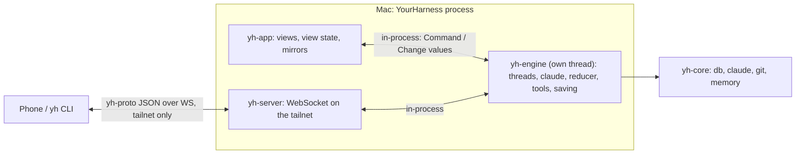

# Remote: the foundation

Status: in progress. Done: F0 (`yh_core::thread_run`), F1's first step (`yh-engine`: turns on
the engine's thread), and a first `yh-proto` and `yh-server` (see "The order changed" below).
Next: Tailscale (F3), then F1's steps 2 and 3.

## The order changed (2026-11-09)

The phone app is being built in parallel (`mobile` branch, docs/mobile.md), on a development
server that only reads the database. What it was waiting for (sending, stopping, answering
cards, live "working" and "waiting on you") the engine already had after F1's first step, so the
protocol and the server came next, before F1's steps 2 and 3, which matter for a headless node
rather than for the phone:

- **`yh-proto`** is the phone's wire as it was (same message names and shapes), plus `live` (a
  thread's run: working, requests waiting on you, MCP questions, the queue, context), `done` (an
  action's answer), a thread's `running` and `waiting`, and the actions `send`, `stop`,
  `respond`, `withdraw`, `send_now`. Protocol 2; only additions, so either side reads the other.
- **`yh-server`** started as the phone's development server, so the phone switches by changing
  its address. Rows and the thread list still come from the database (about once a second while
  a reply streams); live state comes from the engine as it happens (`EngineHandle::subscribe`);
  actions go to the app's main thread and are taken as a click would be (`Workspace::remote_action`),
  so slash commands, titles and notifications behave the same.
- **Running it:** `YH_SERVER=<port>` (`1`: 7878) starts it inside the app, on `127.0.0.1` only,
  with a token (`YH_SERVER_TOKEN`, or made up); it prints `SERVER <url>` and writes the URL to
  `server.json` in the data folder, readable only by you. A wrong or missing token gets 401.
- **Trying it:** `cargo run -p yh-server --example yh -- <url> watch|send|stop|allow|deny|withdraw|send-now …`.
  Checked with a real Haiku turn started from it: the permission card reached the client, which
  allowed it, and the turn ran to its end on the Mac.
- **Protocol 3 (since):** the whole app from a client: questions, plans, MCP questions, new
  threads, model, effort and mode, thread actions, pictures, whole tool output; `done` comes once
  the app took the action. Real streaming came too (rows from the engine). See docs/mobile.md.
- **Was still to do for the phone (most done since):** real streaming (`TextAppended` from the engine rather than rows
  from the database), resuming from a `rev` after a reconnect, a query for a whole tool result,
  answering questions and plans with their content (not only allow and deny), MCP questions,
  uploads, and the device's push token (docs/mobile.md lists them).

## Goal

Let something other than this window drive the app's threads: a phone over Tailscale first,
then the app on another Mac, then a headless node on a Mac mini. This document covers the
**foundation** only, the part every one of those needs:

1. an **engine** that owns threads, their `claude` and their rows, with no GPUI;
2. a **protocol** for it: commands in, changes out;
3. a **server** that speaks the protocol to paired devices on the tailnet.

When it's done, a device on your tailnet can list threads, watch a live turn, send, stop, and
answer permission prompts, questions and plans. A small command line client (`yh`) proves it. The mobile
app, several nodes in one sidebar, a headless daemon and push notifications all build on this
and are out of scope here.

**Nothing gets slower.** The app keeps the engine in-process. Every phase ships on its own with
no visible change, and is measured against the last release before it lands.

## Model

**Each thread has one owner.** A thread lives on the node whose disk has its folder, its
`claude` process, its `~/.claude` session and its dev servers. That node's engine is its only
writer. Every other client (the window, the phone, later another Mac) holds a mirror and sends
commands. Transcripts are append-only from one writer, so they never conflict. "Two-way" means
any client can act, not that every client keeps a full copy.

The few things several clients edit (title, pin, settle, drafts, settings) are commands to the
owner, applied in arrival order. Merge rules only come in with several nodes, later.

## Where things stand (0.1.0)

`yh-core` has no GPUI, but the behaviour that matters lives in `yh-app/src/state`, mixed with
view state:

- **`Workspace`** (`state/workspace.rs`, 3,400 lines) holds both:
  - the engine's job: `library`, `runtimes` (each thread's `ClaudeProcess`, idle reaper,
    restarts), `pump` (events taken once a frame, catalog, limits, session, footprints, saving,
    turn ends), `send_message` (600 lines), `respond_to`, `stop`, `approve_plan`, elicitations,
    titles, keep awake, settling idle and merged threads, `turn_baselines`, `scans`,
    `pull_counts`, `merge_links`, slash commands, side chats, memory agents, the
    `ToolRequest` channel the in-app MCP servers ask through;
  - view state: `selected`, `page`, `panel`, `shows_inspector`, `undo` (it holds an
    `Entity<ThreadState>`), `undo_at`.
- **`ThreadState`** (`state/thread.rs`) is a GPUI entity that's rows, reducer and view at once:
  - data: `items` of `Rc<RefCell<Entry>>`, `permissions`, `queue`, `elicitations`, `sign_in`,
    `running`, `session_id`, `jobs`, `plan`, `composer` (context, MCP servers), `subagents`;
  - reducer state: `blocks`, `tools`, `agent_alias`, `dirty`, `full_results`;
  - view state: `list: ListState`, `find_hit`, `find_query`, `folds`, `open_turns`,
    `inspected_subagent`, and each `Entry`'s `markdown` cache and `open`.
- **The reducer is already nearly free of GPUI:** `apply_event` takes a `Context` it barely
  uses. Moving it is mechanical; separating its state from view state is the work.
- **23 files hold an `Entity<Workspace>`**, and call its methods directly. That's the command
  surface the protocol has to cover.
- **The in-app MCP servers** (`thread_tools.rs`, `harness_tools.rs`) already ask the main
  thread over a channel (`ToolRequest`). That pattern carries over unchanged.

## Decisions

These are proposed. The ones marked **choose** need your call before work starts.

### The engine runs on its own thread (choose)

`yh-engine` is plain Rust: one engine thread owns all state, takes `Command`s from a channel,
and puts out `Change`s. The window drains changes at most once a frame, as `pump` does with
Claude's events today, and splices the rows they touch.

- **Why:** the reducer, saving and turn bookkeeping leave the main thread, so the change can
  only lower main-thread time. The same values that cross the thread are what the protocol
  encodes, so the in-process and remote paths are the same code.
- **The alternative:** keep the engine as GPUI entities on the main thread behind an API. Less
  to move, but every remote client then waits on the UI thread, and a server needs GPUI to run.

### The window keeps view state only

Selection, page, panel, inspector, scroll and list state, Find, folds and opened turns, the
picked sub-agent, the markdown cache, hover, window frames. Mac effects stay too: notifications
and the Dock badge, Finder, Terminal, Quick Look, open panels, the updater.

The engine decides *that* a thread needs you (`Change::Attention`). The window decides whether
to notify.

**Undo** becomes engine commands. Delete already defers the purge to quit, so ⌘Z sends
`Restore { thread }` instead of holding the entity.

**Drafts** stay on the thread record, saved by the engine as now, so a phone sees what you
were typing. Whether they should be per device is a question for later.

### Rows: values in the engine, view rows in the window

`ThreadState`'s `Entry` is `Rc<RefCell<…>>` with a markdown cache: not `Send`, and view-only.

- **The engine** keeps `EntryData` values (`Send`, `Serialize`), only for each thread's open turn
  plus what isn't saved yet, and the reducer's indices (`blocks`, `tools`, `agent_alias`). History
  is in the database, and the window reads pages through a query.
- **The window** keeps `Entry` as now, made from the changes it gets.
- **Cost:** the open turn's rows are held twice. That's a few rows per running thread, against the
  160 to 300 the window holds. Check `footprint` with 20 streaming threads.
- **What F0 found:** the reducer does reach back past the open turn: a background sub-agent or
  job finishing in a later turn, a sub-agent continued after a restart (its call found by the
  `agentId` in its result), `/compact`'s repeated command outputs, and the files a turn changed,
  set after it ends. `ThreadRun` asks a `RowSource` for those rows. In-process that's the
  window's held rows, the same reach as before; the engine's will be the database, which reaches
  further (a row the window let go of no longer loses its update).

### Commands, changes, snapshots

- **IDs are made by the client** for what it creates: a new thread, a message. `new_thread`
  takes its id rather than returning one, and a resent `Send` with the same message id does
  nothing. That makes commands safe to retry over a flaky connection.
- **Results:** each command carries a request id, and a `Reply` comes back with it. Calls that
  return something today (`mention_files`, `folder_files`, `mcp`, `resume_session`,
  `import_session`) become awaited replies.
- **Subscriptions:**
  - `App`: projects, the thread list (metadata plus running, unread, waiting), settings,
    limits, models, the CLI's status;
  - `Thread`: a snapshot of the newest page and the thread's live state (requests, queue,
    jobs, context, activity), then changes. Earlier pages are queries.
- **Changes:**
  - rows: `RowAdded(EntryData)`, `RowChanged { seq, fields }`, `RowRemoved(seq)`, and
    `TextAppended { seq, block, text }` for streaming, so a long reply costs only its new
    words;
  - live state: `Running`, `PermissionAsked`, `Answered`, `Queued`, `Jobs`, `Context`, `Activity`;
  - thread list: `ThreadUpserted(ThreadMeta)`, `ThreadRemoved`;
  - `Attention`.
- **Reconnecting** sends a fresh snapshot. A page is 160 rows, so replaying from `rev` isn't
  worth it yet; the `entries.rev` feed is there when it is.

### The wire: JSON over WebSocket (choose)

- **Encoding:** JSON, one message per frame, tagged enums (`{"type": "send", …}`). It's easy to read in
  a log, and it's what Swift's `URLSessionWebSocketTask` and `Codable` take with no extra library.
  MessagePack can come later if a measurement asks for it.
- **Types:** `yh-proto` defines them once, in Rust, and generates Swift (and TypeScript, if a
  web client ever happens) with **typeshare**, so the phone never drifts from the engine.
- **Handshake:** protocol version, app version, node id and name, the `claude` version.
  Unknown message types and fields are ignored, as the stream-json parser does. A client below
  the node's minimum version is told so.

### Tailscale

- **The listener is off by default.** Settings → Devices turns it on.
- **It binds only to the tailnet's addresses** (`tailscale ip`), never `0.0.0.0`. It goes
  quiet when Tailscale is down or isn't installed.
- **Who's connecting:** each connection's peer is checked with `tailscale whois` (the CLI in
  `Tailscale.app`; its LocalAPI later). By default only devices logged in as your own tailnet
  user get through.
- **Pairing, on top of that:** Settings → Devices → Pair shows a QR code holding the node's
  MagicDNS name, its port and a one-time code. The device trades the code for a long-lived
  token, kept in its Keychain. The node keeps only the token's hash, in a `settings` row (no
  schema change). Devices are listed and revocable there.
- **TLS:** WireGuard already encrypts the tailnet. When the tailnet has HTTPS on, the node
  serves `wss://` with `tailscale cert`'s certificate, which iOS prefers. Otherwise it serves
  `ws://`, and the iOS app carries an ATS exception for it.
- **A connection can do anything you can:** run agents, approve commands, read every
  transcript. Treat a paired device like an SSH key.
- **Tailscale sits behind a `Provider` trait** (address, peer identity, certificate), so LAN
  via Bonjour or an SSH tunnel can be added without the engine knowing.

### The browser stays in the app

WebKit needs the app's run loop and window. The engine reaches the browser through a
`BrowserHost` trait whose calls go to the main thread over a channel, the same shape
`ToolRequest` has today. The browser tools keep working for every turn, whoever started it.
Remote clients don't get a browser panel in the foundation (the phone doesn't need one), and
a frame viewer comes with the multi-Mac work.

## Shape

| Crate | What's in it | Depends on |
|---|---|---|
| `yh-core` | As today, plus the reducer (`reducer.rs`). | — |
| `yh-proto` (new) | `Command`, `Reply`, `Change`, snapshots, the handshake; serde and typeshare. No logic. | serde |
| `yh-engine` (new) | Threads and their `claude`, the reducer driving them, saving, titles, settling, keep awake, scans and PR counts, slash commands, side chats, memory agents, the in-app MCP servers; `Engine::start() -> (Sender<Command>, Receiver<Change>)`; `BrowserHost` and `Host` traits for what only the app can do. | yh-core, yh-proto |
| `yh-server` (new) | WebSocket listener, the Tailscale provider, pairing, a session per connection. | yh-engine, yh-proto, tokio |
| `yh-app` | Views, view state, mirrors fed by changes, the Mac edge, the browser. Embeds the engine and, when turned on, the server. | yh-engine, yh-server |
| `yh` (new, small) | Command-line client: `yh threads`, `yh watch <thread>`, `yh send`, `yh stop`, `yh allow` / `yh deny`. For tests, and for the phone's work to start against. | yh-proto |

## Phases

Each ends green on `cargo test`, a real Haiku turn checked by snapshot, and the probes below,
compared with the build before it.

### F0: the reducer leaves `ThreadState`

- `yh_core::reducer::Reducer` takes `claude::Event`s and returns `Vec<RowChange>` over `EntryData`
  values. It holds `blocks`, `tools`, `agent_alias`, the sub-agent logs, the plan and the live
  state (permissions, queue, elicitations, jobs).
- `ThreadState::apply` runs the reducer and applies its changes to its `Entry` rows and view
  state. Behaviour doesn't change.
- Fixture tests: every session in `crates/yh-core/fixtures/` goes through the reducer, and its
  rows are compared with what the app saves today (record them once from 0.1.0).
- Answer the risk above: what does the reducer read outside the open turn?
- **Check:** the follow and scroll checks (`YH_SEND` turns with `YH_WHEEL`), `YH_EXPAND_WORK`
  snapshots, sub-agent and background-job fixtures.

### F1: `yh-engine`, the window as a client

The largest phase, landed in three steps so each can ship:

1. **Turns:** `runtimes`, `pump`, `send_message`, `interrupt`, `stop`, `respond_to`,
   `approve_plan`, elicitations, queue and withdraw, `restart_runtime`, side chats, memory
   agents, turn baselines and saving move to the engine thread. The window's `ThreadState`
   becomes a mirror that applies `Change`s once a frame.
2. **Threads and projects:** new, rename, pin, settle (and the idle and merged rules), delete
   and restore, projects, home folder, model, effort, mode, drafts, titles, slash commands,
   session resume and import, limits, keep awake.
3. **Around:** scans, PR counts and merge links, the in-app MCP servers (`threads`, `harness`,
   `memory`) and `BrowserHost`, memory changes, settings that change what the engine does.

**Step 1, as built:** `yh_engine::start` runs one engine thread that owns every thread's
`ThreadRun` and `claude`. The window's `ThreadState` holds a copy of its `LiveState` and applies
the `RowChange`s it's told, at most once a frame (`Workspace::on_outputs`). The engine starts a
`claude` when a message or a request needs one and asks the app how (`Output::NeedsLaunch`,
answered with `Command::Launch`: the folder, model, tools and prompt are still the app's), so
launch options are made only when a process really starts. It lets idle processes go, starts
one over for a new effort once its turn is over, saves rows as they settle, and reads rows it
let go of back from the database (`Database::find_row`). Every request the UI makes of a turn
(send, steer, stop, allow, answer, withdraw, send now, `/mcp`, stop a job, quit) is a
`Command`. Both golden tests run through it: the engine alone, and the app's thread built from
what the engine tells.

After step 3, no file in `yh-app` reaches `Library` or `ClaudeProcess` directly. A test
enforces it by grepping for them.

- **`probe.rs`** and the `YH_*` launch options that act (`YH_SEND`, `YH_ANSWER`,
  `YH_ACTIONS_PROBE`, `YH_THREAD_ACTIONS`…) go through commands too, so the probes test the
  real path.
- **Check:** `stream-all-everything` and `stream-all-chaos` with no `PERF WRONG` lines and no
  panic, frames on time and clicks no worse than 0.1.0, and `footprint` with 20 streams. These
  are the two full perf runs this work needs: at the end of step 1 and at the end of F1.

### F2: `yh-proto` and the loopback transport

- Every `Command`, `Reply` and `Change` gets serde and typeshare. Add the handshake.
- `YH_TRANSPORT=loopback` encodes every message to JSON and back between the window and the
  engine. It proves nothing bypasses the protocol, and shows what encoding costs.
- **Check:** the F1 probes again, through loopback. Encoding time is printed per frame.
  A Swift file is generated by typeshare and compiles.

### F3: `yh-server`, Tailscale, `yh`

- The WebSocket listener, a session per connection (its subscriptions, its outbox, and dropping
  a client that falls behind), the Tailscale provider, pairing and Settings → Devices.
- The `yh` client.
- **Check:**
  - from a second device on the tailnet (or a second user account on this Mac, through its
    tailnet address), `yh watch` streams a live Haiku turn as the window shows it;
  - `yh send` starts one, `yh allow` answers a card the window shows, `yh stop` stops it;
  - an unpaired device, a revoked token and another tailnet user are refused;
  - the listener isn't there when it's turned off.
- `YH_SERVER=1` and `YH_PAIR_CODE=<code>` let a test turn it on and pair without clicking.
  Tests never touch the real tailnet's settings.

## Risks

- **Main-thread contention moves, it doesn't vanish.** Changes still have to be spliced in a
  frame. Batch them as `pump` batches events, and watch `PERF stall` lines.
- **Two copies of the open turn.** Measure; if it matters, share `Arc<EntryData>` between the
  engine and the window, replaced on change.
- **`send_message` is 600 lines of interleaved concerns.** Split it before moving it, in F1
  step 1's first commit, with no behaviour change.
- **Probes that reach into state** will need rewriting. That's the point, but it costs time.
- **A slow client** must never hold up the engine. Each connection has its own bounded queue,
  and a client that overflows it is dropped and resubscribes.

## After the foundation

These come after, each a plan of its own:

- **The mobile app:** SwiftUI over the typeshare types. Thread list, transcript, send, stop,
  approve, questions and plans, a new thread in a project.
- **Push notifications:** an APNs relay; the node sends only "device X, thread Y needs you".
- **A headless node:** `yh-engine` and `yh-server` in an accessory app on a Mac mini, with
  WebKit for the browser.
- **Several nodes in one sidebar:** grouped by node, an offline cache, merge rules for
  metadata and memory, moving a thread between nodes.
- **Linux nodes:** a different browser engine, and blobs compressed with something other
  than LZFSE.
