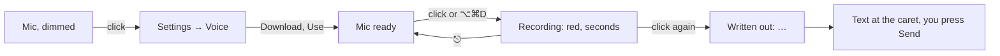

# Voice input

The composer's mic writes what you say into the message; it never sends. Mac only (the phone
has its own, Apple's recognizer: docs/mobile.md).

## Models

`crates/yh-voice/src/catalog.rs`: each with one sentence on what it's good at, gives up and
costs, files pinned to a Hugging Face commit with their sizes and SHA-256s. Nothing is
downloaded until you ask; the first one downloaded becomes the default (the `voice` setting,
`{"model": <id>}`). Files go to `<data>/voice-models/<id>/`, as `<name>.part` until their
checksum matches (curl picks a stopped download up where it left off).

| Model | Engine | Download | 40 s of speech | Memory loaded |
|---|---|---|---|---|
| Whisper Large v3 Turbo (q5, recommended) | whisper.cpp, Metal | 574 MB | ~1.6 s | 0.8 GB |
| Parakeet TDT 0.6B v2 (English only) | sherpa-onnx, CPU | 661 MB | ~1.1 s | 1.6 GB |
| Whisper Base | whisper.cpp, Metal | 148 MB | ~0.3 s | 0.4 GB |
| Apple | SFSpeechRecognizer | none | | small |

They were picked by `scripts/voice-bench/` (12 models over coding prompts in five accents,
with and without room noise, LibriSpeech, Ukrainian, Russian, and the user's own voice in
three languages): Turbo was the most accurate, and the only one to keep English code words as
written inside Ukrainian or Russian; Parakeet v2 the best on natural English, and fastest.
Whisper gets the project's name as its prompt, which helps it spell it.

## How it runs

- `yh_voice::Worker`: one thread (user-initiated QoS) holds the model in use. A recording's
  start loads it, so it's ready when you stop; five idle minutes let it go.
- whisper.cpp runs with flash attention (whisper-rs turns it off by default; a third slower).
- sherpa-onnx is linked as a dylib, not statically: its static onnxruntime runs Parakeet at
  half the speed. `scripts/bundle.sh` copies `libsherpa-onnx-c-api.dylib` and
  `libonnxruntime.dylib` into `Contents/Frameworks` and signs them; `build.rs` sets the rpaths.
- whisper.cpp's GPU teardown at exit aborts if a model is still loaded, so an `atexit`
  handler (registered after the first load, so it runs before ggml's) lets go of it first.
- Audio: CoreAudio through cpal, averaged to mono, resampled to 16 kHz when you stop. Silence
  never reaches Whisper (it makes up "Thank you." from nothing). A recording stops itself
  after ten minutes.
- Permissions: the microphone is asked for on the first recording (`NSMicrophoneUsageDescription`);
  Apple's recognizer asks for Speech Recognition when first used. Denied, CoreAudio records
  silence, so the permission is checked first and the mic says why.
- The composer redraws only when what the mic shows changes (once a second while recording),
  not on every download progress tick.

## Building

whisper-rs builds whisper.cpp with cmake: it needs an arm64 `cmake` (`brew install cmake`), or
`CMAKE=<path>` pointing at one. sherpa-onnx's build downloads its prebuilt libraries from
GitHub into `target/sherpa-onnx-prebuilt/`.

## Testing

Never a real microphone or Speech Recognition from a test (they ask for permission):
`YH_VOICE_FILE=<audio>` stands in for the mic, `YH_VOICE_MODELS=<folder>` holds the models
(make one from `cp -c` clones), `YH_VOICE_USE=<id>` picks one, `YH_VOICE_DOWNLOAD=<id>` presses
its Download, `YH_VOICE_LOG=1` prints the worker's loads and timings. ⌥⌘D goes through the
window as `YH_THREAD_ACTIONS=key:alt-cmd-d,key:alt-cmd-d`. `VOICE …` lines say what was heard
and what the composer holds. Files through a model without the app:
`cargo run -p yh-voice --release --example transcribe <models> <id> <audio>… [--download]`.
